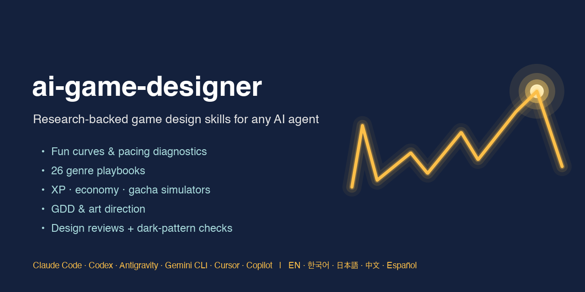
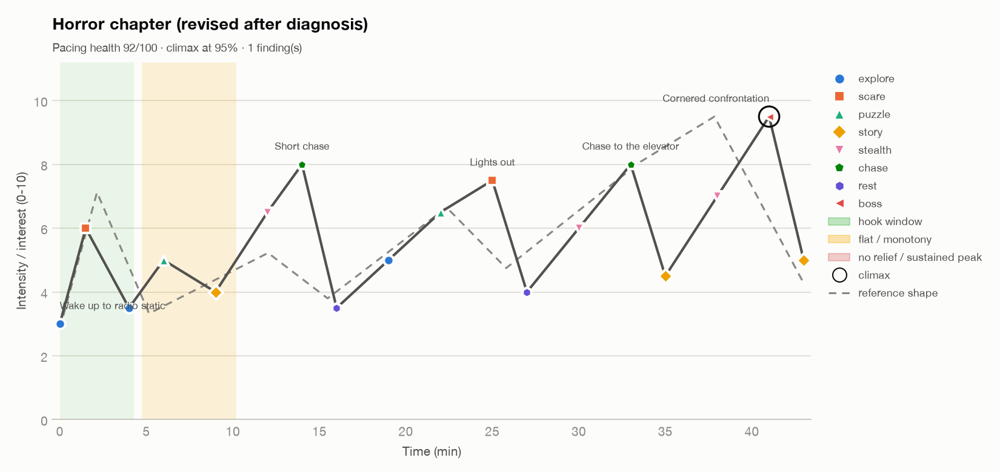
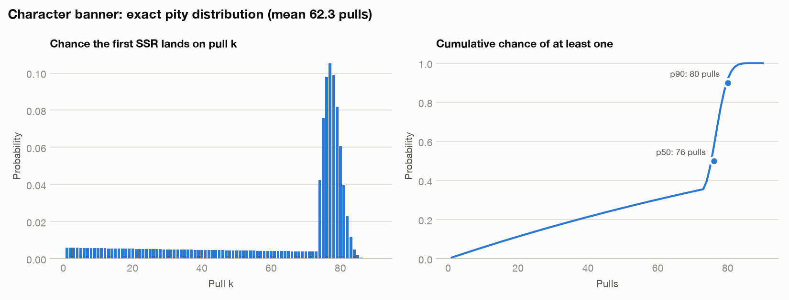
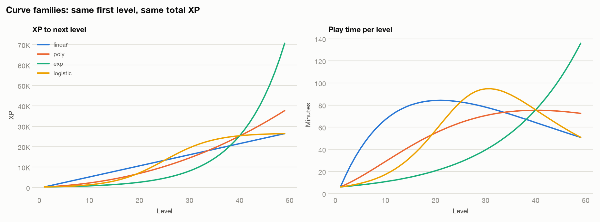
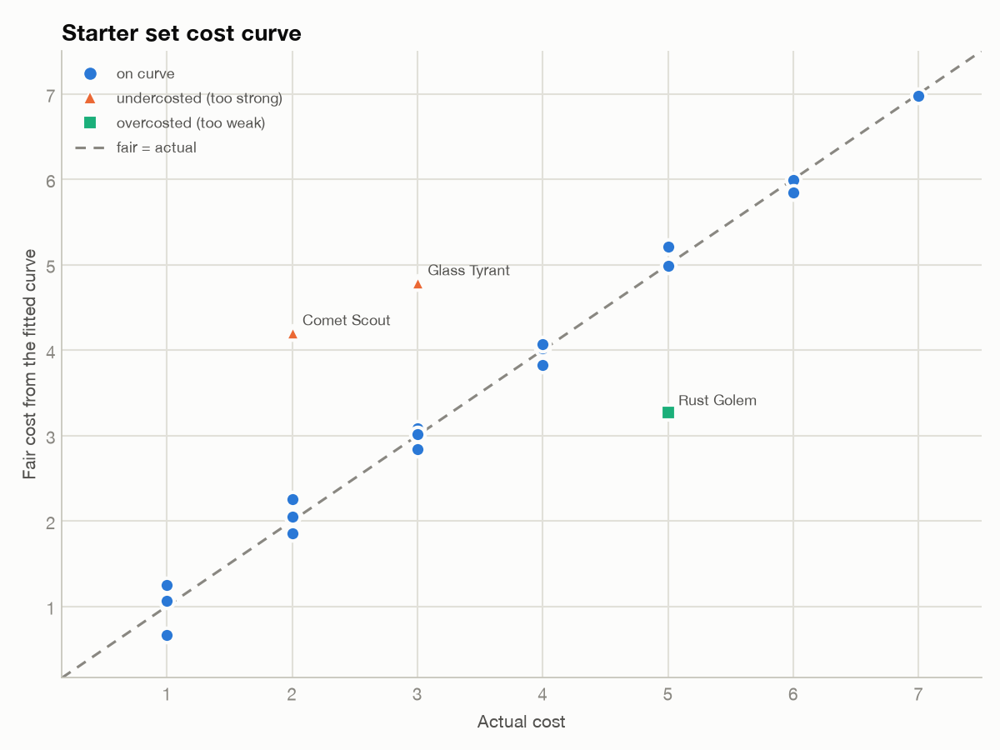

<p align="center">
  
</p>

<p align="center">
  <a href="LICENSE"></a>
  
  
  
  
</p>

<p align="center"><a href="README.md">English</a> · <b>한국어</b></p>

# ai-game-designer

**어떤 AI 에이전트든 근거를 대며 일하는 시니어 게임 디자이너로.** 첫 콘셉트부터 소프트 런칭까지, 모든
장르를 다루는 스킬 6개입니다. 그래프로 그려 보는 페이싱, 시뮬레이션으로 확인하는 수치, 팀이 실제로
읽는 문서, 그리고 플레이어나 규제 기관보다 먼저 다크 패턴을 잡아내는 리뷰를 제공합니다.

- **연구 기반.** 모든 레퍼런스 파일에 출처가 달려 있습니다. GDC 강연, 개발자 포스트모템, 서적,
  동료 심사를 거친 게임 연구를 근거로 했고, 신뢰도 등급을 매긴 120개 이상의 참고문헌을
  [`research/`](research/)에서 볼 수 있습니다.
- **실제로 분석합니다.** 재미 곡선 플로터와 페이싱 진단, 경험치 곡선 솔버, 정확한 천장 계산을
  포함한 몬테카를로 경제·가챠 시뮬레이터, 비용 곡선 이상치 탐지기를 함께 제공합니다. 모두
  Python 3만 있으면 되고 matplotlib은 선택입니다.
- **모든 장르.** 플랫포머부터 MMO, 방치형부터 기능성 게임까지 26개 장르 플레이북에 장르 혼합
  설계법까지 담았습니다.
- **당신의 언어로 답합니다.** 질문한 언어를 감지해 그 언어로 답하고, 전문 용어는 처음 나올 때
  `관심 곡선 (Interest Curve)` 처럼 영어를 병기합니다. 5개 언어 용어집이 함께 들어 있습니다.
- **쓰는 에이전트 그대로.** Claude Code, OpenAI Codex, Antigravity, Gemini CLI용 네이티브 패키지와,
  Cursor·Copilot·OpenCode 등 `SKILL.md` 폴더를 읽는 모든 에이전트용 설치 스크립트를 제공합니다.
  스킬로만 구성되어 MCP 서버, API 키, 훅이 필요 없습니다.

> 비공식 커뮤니티 프로젝트이며 Anthropic, OpenAI, Google과 제휴하거나 보증받지 않았습니다.

---

## 구성

| 스킬 | 하는 일 | 함께 제공 |
|---|---|---|
| **`game-design`** | 진입점이자 라우터. 장르·플랫폼·세션·대상·단계를 빠르게 파악한 뒤 디자인 브리프를 만듭니다. MDA 미학, 검증 질문이 붙은 디자인 기둥, 세 시간 단위의 코어 루프, 리스크와 가장 싼 검증법이 들어갑니다. 다국어 규칙도 이 스킬에 있습니다. | 프레임워크, 플레이어 동기 모델, 5개 언어 용어집 |
| **`fun-curve`** | 전투 하나, 레벨, 런, 게임 전체의 관심 곡선·몰입·페이싱을 설계하고 진단합니다. 훅 부재, 평탄 구간, 이완 없는 피크, 너무 이른 클라이맥스, 상승하지 않는 피크를 잡아냅니다. | `fun_curve.py`, 페이싱 모델, 게임 필·플레이테스트 가이드 |
| **`genre-design`** | 장르별 플레이북. 코어 루프, 대표 메커닉, 페이싱 형태, 성장 모델, 밸런스 레버, 실패 요인, 레퍼런스 게임과 *그것이 통하는 이유*, 근거 강연까지 정리했습니다. | 26개 플레이북 + 장르 혼합 설계법 |
| **`balance-economy`** | 경험치 테이블, 전투 수식(TTK·DPS·방어), 비용 곡선, 재화 유입처·소모처, 인플레이션, 드롭률, 천장, 2026년 확률형 아이템 규제 현황. | `progression_curve.py`, `economy_sim.py`, `cost_curve.py` |
| **`gdd-art-direction`** | 원페이지 기획서, 살아 있는 GDD, 기능 명세서, 규모 산정이 들어간 에셋 리스트, 아트·오디오 스타일 가이드, 가독성·실루엣 기준, 접근성 체크리스트. | 템플릿 5종, 접근성(GAG/XAG/APX) 가이드 |
| **`design-review`** | 콘셉트·명세·빌드·플레이테스트 노트를 구조적으로 비평합니다. 우선순위가 매겨진 문제와 근거, 구체적인 해결책을 내고, 다크 패턴 **윤리 점검을 반드시** 함께 수행합니다. | 리뷰 렌즈 12종, P0–P3 기준, 다크 패턴 분류표 |

## 이렇게 동작합니다

**페이싱을 진단하고, 고치고, 확인합니다.** 결함 있는 호러 챕터(왼쪽)가 건강한 곡선(오른쪽)으로
바뀝니다. 스크립트가 훅 부재, 11분간 이어지는 추격 고원, 58% 지점의 클라이맥스를 찾아냈습니다.
([워크스루](skills/fun-curve/examples/horror-fix-walkthrough.md))

<p align="center">
  
  
</p>

**플레이어가 체감하는 수학을 모델링합니다.** 기본 확률 0.6%, 74회부터 소프트 천장, 90회 하드 천장인
가챠의 정확한 분포는 평균 62.3회, 종합 확률 1.61%입니다. 첫 레벨과 총 경험치를 같게 맞춘 네 가지 곡선
계열을 플레이어가 실제로 느끼는 레벨당 플레이 시간으로 비교합니다.
([경제 워크스루](skills/balance-economy/examples/economy-walkthrough.md) ·
[경험치 테이블](skills/balance-economy/examples/rpg-xp-table.md))

<p align="center">
  
  
</p>

**사기 카드를 찾아냅니다.** 최소제곱 비용 곡선으로 각 능력치의 가치를 역산하고 비용이 낮거나 높게
책정된 카드를 표시합니다. ([워크스루](skills/balance-economy/examples/card-cost-curve.md))

<p align="center"></p>

## 쇼케이스: 실제 세션 6개

**Claude Code, Codex, Antigravity** 세 에이전트로 디자인 세션 6개를 **병렬로** 돌렸습니다. 한국어,
영어, 일본어, 스페인어, 중국어로 진행했고, 세션마다 새 프로젝트 폴더에서 독창적인 콘셉트를 다뤘습니다.
에이전트가 만든 결과물 전부가 [`showcase/`](showcase/)에 있습니다.

| 에이전트 | 언어 | 콘셉트 | 결과 |
|---|---|---|---|
| Claude Code | 한국어 | 몬스터 농장 힐링 게임 | 하루 페이싱 29 → 92, 브리프와 원페이지 기획서 |
| Claude Code | English | 조류 마법 덱빌더 | 비용 곡선 R² 0.71 → 0.96, 런 곡선 수정 |
| Claude Code | 日本語 | F2P 가챠 RPG | 인플레이션 5.12:1 → 1.00, 최악의 경우 300 → 120연차, 과금 리뷰 |
| Codex | English | 호러 등대 챕터 | 페이싱 문제 12 → 0, 접근성 체크리스트 |
| Antigravity | Español | 정원 타워 디펜스 | 30레벨 성장 설계, 비용이 어긋난 타워 2개 수정 |
| Codex | 中文 | 방치형 우주 채굴 | 환생 페이싱, 다크 패턴 점검이 포함된 리뷰 |

실사용에서 빈틈도 하나 찾았습니다. 가챠 시뮬레이터에 50/50 보장과 교환(스파크) 천장이 없었는데,
1.1.0에서 고쳤습니다 ([자세히](showcase/README.md#what-real-use-taught-us-and-what-changed-in-110)).

---

## 설치

| 에이전트 | 방법 |
|---|---|
| **Claude Code** | `/plugin marketplace add bunhine0452/ai-game-designer` 후 `/plugin install game-designer@ai-game-designer` |
| **OpenAI Codex** | `codex plugin marketplace add bunhine0452/ai-game-designer` 후 `codex plugin add game-designer@ai-game-designer` |
| **Antigravity** | 저장소를 클론한 뒤 `agy plugin install ./ai-game-designer` |
| **Gemini CLI** | `gemini extensions install https://github.com/bunhine0452/ai-game-designer` |
| **Cursor, Copilot, OpenCode 등** | 클론 후 `./install.sh --agent cursor` (또는 `copilot`, `opencode`, `universal`). 아래 참고 |
| **Claude 앱** (claude.ai / 데스크톱) | [최신 릴리스](https://github.com/bunhine0452/ai-game-designer/releases/latest)의 `game-designer.plugin` 또는 스킬별 zip 업로드 |

### `SKILL.md` 폴더를 읽는 모든 에이전트

```bash
git clone https://github.com/bunhine0452/ai-game-designer
cd your-game-project
../ai-game-designer/install.sh                      # ./.agents/skills (Codex, Gemini CLI, Antigravity 등)
../ai-game-designer/install.sh --agent claude --scope user
../ai-game-designer/install.sh --list-agents        # 지원하는 대상과 경로 목록
```

설치 스크립트는 스킬 6개를 복사하고, 스킬마다 공용 용어집을 함께 넣습니다. `--link`를 주면 복사 대신
심볼릭 링크를 만듭니다. 다른 에이전트라면 `--dest <dir>`로 경로를 지정하세요. 저장소는 표준
`skills/<name>/SKILL.md` 구조를 따르므로 커뮤니티 CLI인 `npx skills add bunhine0452/ai-game-designer`
도 인식합니다 (이 프로젝트에서 직접 테스트하지는 않았습니다). 스킬을 지원하지 않는 에이전트는
[`AGENTS.md`](AGENTS.md)를 따르면 됩니다.

### Claude 앱 참고

라우터이자 용어집을 담은 `game-design.zip`을 먼저 올리세요. 스크립트가 실행되도록 **코드 실행**을
켭니다. matplotlib이 있으면 차트가, 없으면 텍스트와 CSV가 나옵니다. 메뉴 이름은 앱 버전에 따라 다를
수 있으니 설정에서 "Skills"나 "Plugins"를 찾으세요.

Claude Code에서는 질문 내용에 맞춰 스킬이 자동으로 실행되고, `/game-designer:fun-curve` 처럼 직접
호출할 수도 있습니다.
---

## 사용 예시

어떤 언어로 물어도 됩니다. 아래는 시작점일 뿐입니다.

| 스킬 | 한국어 | English |
|---|---|---|
| `game-design` | "빛이 체력이자 재화인 짧은 런 로그라이트를 만들고 싶어. 디자인 브리프 써줘." | "Help me write a design brief for a cozy monster-farming game." |
| `fun-curve` | "15분짜리 던전이 중반에 지루해. 비트는 이래… 뭐가 문제야?" | "Plot the interest curve of my 20-minute run and find the flat zones." |
| `genre-design` | "메트로배니아에서 플레이어가 기대하는 것과 차별화 방법 알려줘." | "What are the conventions and common failure modes of roguelike deckbuilders?" |
| `balance-economy` | "50레벨 경험치 테이블 만들어줘. 만렙까지 40시간 정도." · "이 경제 JSON을 60세션 돌려줘." | "With a 0.6% rate and pity at 90, how many pulls on average? What must I disclose?" |
| `gdd-art-direction` | "떠 있는 섬에서 낚시하는 힐링 게임 원페이지 기획서 써줘." | "Create an art style guide for a two-person team, including silhouette and readability rules." |
| `design-review` | "과금 구조 리뷰해줘: 출석 연속 보상이 하루 빠지면 초기화, 에너지는 젬으로 충전, 레어 0.5%에 천장 없음." | "Turn my playtest notes into prioritized issues." |

일본어, 중국어, 스페인어도 이해합니다 (예: 「ホラーの緩急を見て」, 「塔防加放置怎么结合？」,
"lista de accesibilidad para mi juego de plataformas").

## 다국어 동작 방식

- 가장 최근 메시지의 언어로 답합니다. 파일이나 인용문이 다른 언어여도 마찬가지입니다.
- 영어가 아닌 답변에서는 전문 용어가 처음 나올 때 **현지어 (English)** 형식으로 씁니다. 예:
  `관심 곡선 (Interest Curve)`, `天井 (Pity)`, `心流 (Flow)`, `bucle principal (Core Loop)`. 그다음부터는
  현지어만 씁니다.
- 용어는 EN·KO·JA·ZH-Hans·ES 130개 이상을 담은 [용어집](skills/game-design/references/glossary.md)을
  따릅니다.
- 코드, 파일명, CLI 플래그, 스크립트 출력은 영어로 유지하고, Claude가 그 내용을 당신의 언어로
  요약해 줍니다.

## 스크립트 한눈에 보기

| 스크립트 | 입력 | 출력 |
|---|---|---|
| `skills/fun-curve/scripts/fun_curve.py` | 비트 CSV/JSON (`time,intensity,type,label`) | 차트, 리포트(MD/JSON), 리샘플 CSV, ASCII 곡선 |
| `skills/balance-economy/scripts/progression_curve.py` | CLI 옵션 (곡선 계열, 레벨 수, 첫 레벨, 총량, 수입) | 경험치 테이블(CSV), 리포트, 차트 |
| `skills/balance-economy/scripts/economy_sim.py` | 경제 JSON (재화, 플레이어 유형, 유입처, 소모처, 가챠) | 세션별·플레이어별 CSV, 정확한 천장 분포 CSV, 리포트, 차트 |
| `skills/balance-economy/scripts/cost_curve.py` | 아이템 CSV (`name,cost,attributes…`) | 능력치별 가치, 적정 비용, 이상치, 차트 |

모든 스크립트는 Python 3 표준 라이브러리만 사용합니다. matplotlib이 없으면 차트 대신 텍스트와
CSV를 만듭니다.

## 리서치

리서치를 먼저 했습니다. [`research/RESEARCH_NOTES.md`](research/RESEARCH_NOTES.md)(분야별 결과)와
[`research/SOURCES.md`](research/SOURCES.md)(신뢰도 등급이 붙은 전체 참고문헌)를 보세요. 주요 출처:
Schell의 관심 곡선, Csikszentmihalyi와 Chen의 플로우 연구, Left 4 Dead의 AI 디렉터, MDA, Lazzaro의 Four
Keys, Quantic Foundry, SDT/PENS, Koster, Swink, *Juice it or lose it*, Valve의 플레이테스트, RITE, PXI와
GEQ 비교, Schreiber의 *Game Balance*, Sirlin, Machinations, Pecorella의 방치형 수학, 확률형 아이템에 관한
Zendle & Cairns 연구, Librande의 원페이지 기획서, TF2의 가독성 설계, Riot의 명확성 가이드라인, Game
Accessibility Guidelines, Xbox Accessibility Guidelines, APX. 모든 내용은 재서술하고 출처를 밝혔으며
원문을 그대로 옮기지 않았습니다.

근거가 약한 영역은 그렇다고 밝혔습니다 (레이싱, 배틀로얄, 파티 게임은 1차 자료가 적습니다).
확률형 아이템 규제 정리는 **2026년 10월** 기준이며 **법률 자문이 아닙니다**.

## 다른 프로젝트와 비교

인기 있는 게임 개발 에이전트 프로젝트들은 *제작 공정*(스튜디오 역할극 에이전트)이나
*엔진*(Godot·Unity·Phaser 스킬)에 집중합니다. 이 플러그인은 **디자인 지식과 분석**에 집중합니다.
출처가 달린 플레이북, 실행 가능한 모델, 윤리 점검 층이 핵심입니다. 여러 에이전트에서 동작하고,
엔진·제작 플러그인과 함께 쓰기 좋습니다. 경쟁 분석은
[`research/RESEARCH_NOTES.md`](research/RESEARCH_NOTES.md#e-competitive-scan)에 있습니다.

## 품질 검증

- 각 에이전트의 검증 도구를 모두 통과했습니다: `claude plugin validate --strict`, `agy plugin validate`,
  `gemini extensions validate`, Codex 마켓플레이스 설치(`codex plugin marketplace add` → `codex plugin add`).
- Codex와 Antigravity 모두 프로젝트의 `.agents/skills` 폴더에서 스킬 6개를 전부 인식했습니다.
- 모든 스크립트를 동봉된 예제로 실행해 확인했습니다 (matplotlib 유무 모두).
- `evals/`: 스킬당 3개씩 총 18개의 트리거·언어 테스트 케이스가 있습니다 (영어, 한국어, 그리고 일본어·
  중국어·스페인어 중 하나). `claude plugin eval .` 로 실행합니다. v1.0.0 실행 결과(Sonnet, 케이스당 1회):
  올바른 스킬 실행 18/18, 사용자 언어로 답변 18/18, 유용한 답변 18/18, 영어 병기 용어 표기 12/12.

## 기여

원어민의 용어집 수정, 새 장르 플레이북, 더 나은 출처, 새 예제 워크스루를 환영합니다.
[CONTRIBUTING.md](CONTRIBUTING.md)를 참고하세요.

## 라이선스

[MIT](LICENSE) © bunhine0452
