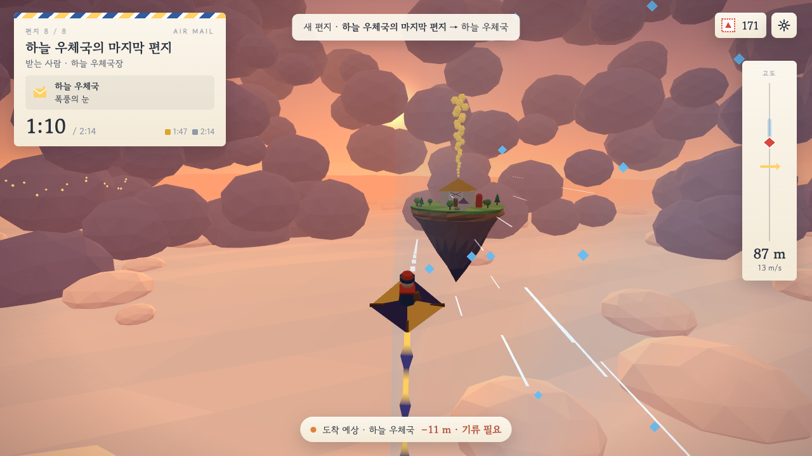
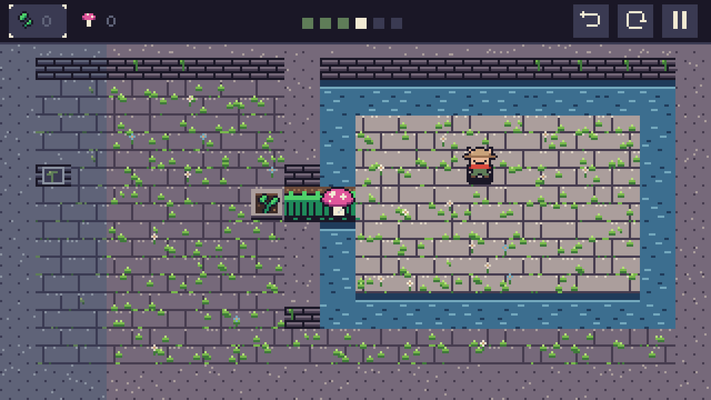
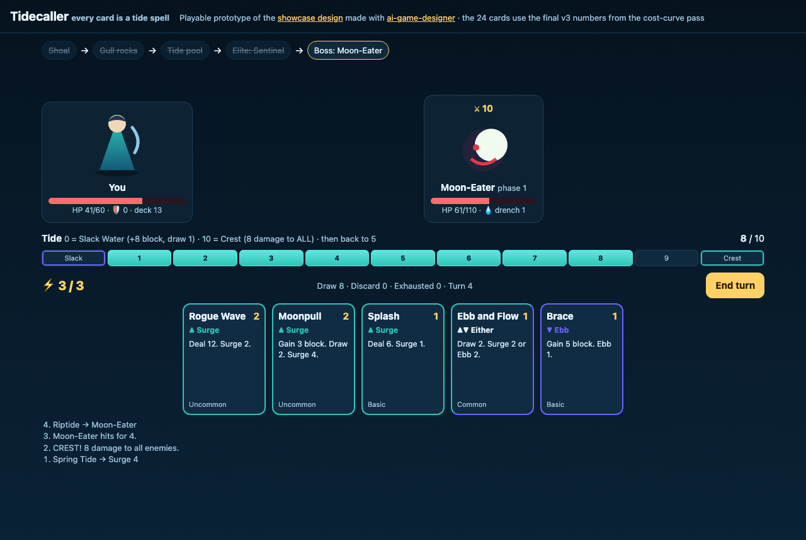
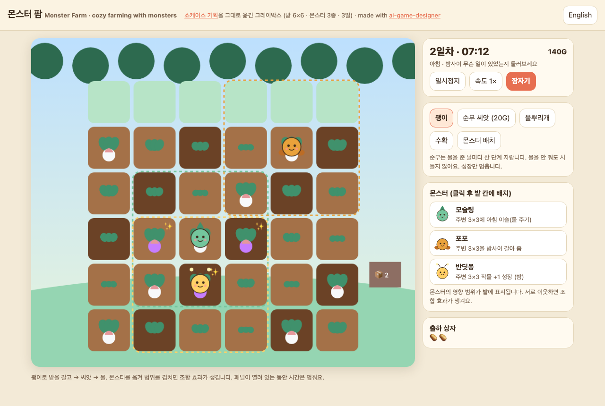
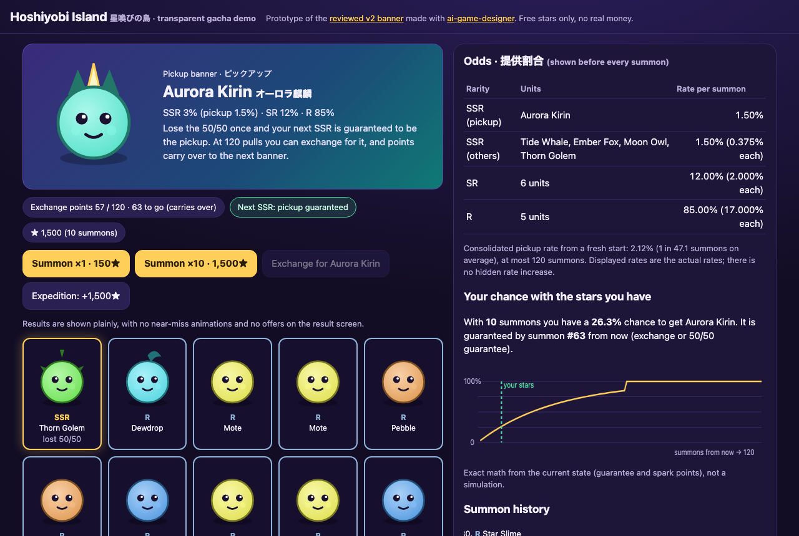
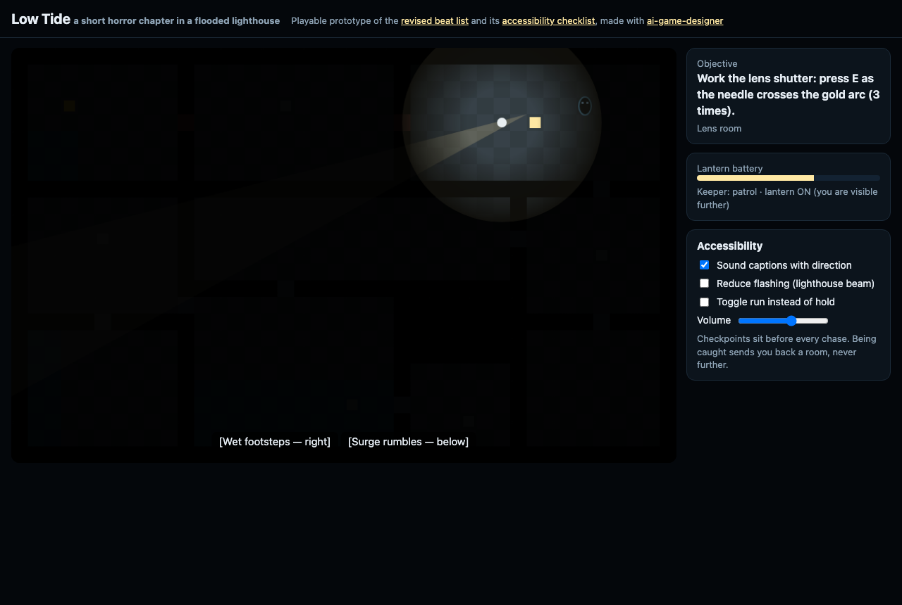
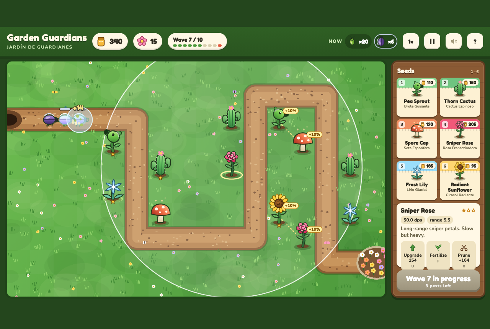
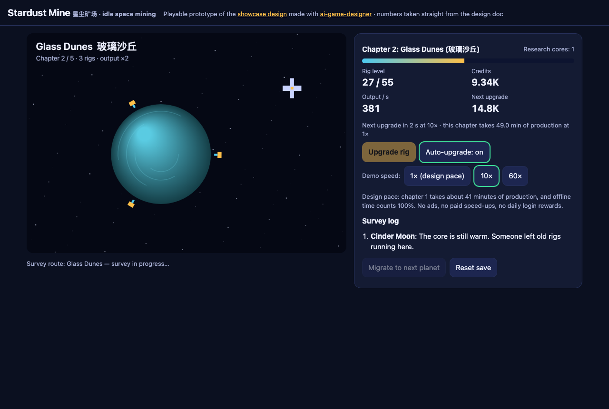
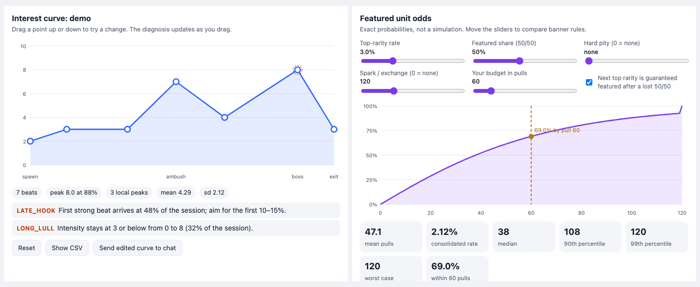

<p align="center">
  
</p>

<p align="center">
  <a href="LICENSE"></a>
  
  
  
  
</p>

<p align="center"><b>English</b> · <a href="README.ko.md">한국어</a></p>

# ai-game-designer

**Turn any AI agent into a senior game designer who can show its work.** Seven skills cover every genre,
from first concept to soft launch: pacing you can plot, numbers you can simulate, documents your
team will actually read, and reviews that catch dark patterns before players or regulators do.

- **Research-backed.** Every reference file cites its sources: GDC talks, designer postmortems,
  books and peer-reviewed games research. A 120+ entry bibliography with trust levels is in
  [`plugins/game-designer/research/`](plugins/game-designer/research/).
- **Runs real analysis.** It ships with a fun-curve plotter with pacing diagnostics, an XP curve
  solver, a Monte Carlo economy and gacha simulator with exact pity math, and a cost-curve
  outlier finder. They need only Python 3; matplotlib is optional.
- **Covers every genre.** 26 playbooks, from platformers to MMOs and from idle games to serious
  games, plus a method for designing hybrids.
- **Answers in your language.** It detects the language you write in, answers in it, and
  shows each technical term with the English term on first use, e.g. `관심 곡선 (Interest Curve)`.
  A 5-language glossary ships with it.
- **Works with your agent.** Native packages for Claude Code, OpenAI Codex, Antigravity and Gemini
  CLI, plus an installer for Cursor, Copilot, OpenCode and any agent that reads `SKILL.md`
  folders. Skills only: no MCP servers, API keys or hooks.

> Unofficial community project. Not affiliated with or endorsed by Anthropic, OpenAI or Google.

---

## What's inside

| Skill | What it does | Ships with |
|---|---|---|
| **`game-design`** | Entry point and router. Runs a quick intake (genre, platform, session, audience, stage) and produces a design brief: MDA aesthetics, pillars with test questions, core loops at three time scales, and risks with their cheapest tests. Holds the multilingual rules. | Frameworks, player-motivation models, 5-language glossary |
| **`fun-curve`** | Designs and critiques interest curves, flow and pacing for an encounter, level, run or whole game. Flags missing hooks, flat zones, peaks without relief, early climaxes and peaks that don't escalate. | `fun_curve.py`, pacing models, game-feel and playtest guides, evidence on what players enjoy |
| **`genre-design`** | Genre playbooks: core loop, signature mechanics, pacing shape, progression, balancing levers, failure modes, reference games and *why* they work, and the talks behind them. | 26 playbooks plus a hybrid-genre method |
| **`balance-economy`** | XP tables, combat math (TTK, DPS, armor), cost curves, faucets and sinks, inflation, drop rates, pity, and the 2026 loot-box legal landscape. | `progression_curve.py`, `economy_sim.py`, `cost_curve.py` |
| **`gdd-art-direction`** | One-page designs, living GDDs, feature specs, asset lists with scope estimates, art and audio style guides, readability and silhouette rules, accessibility checklists. | 5 templates, pixel-art and 3D direction guides, accessibility (GAG/XAG/APX) guide |
| **`playable-prototype`** | Turns design documents into a single-file browser prototype whose numbers come straight from the docs, with procedural art and sound, self-tests (`?test=1`), bots that play it start to finish, and screenshots. | 2D, pixel-art and three.js templates, `check.py` runner, 8 live examples |
| **`design-review`** | Structured critique of concepts, specs, builds or playtest notes, with prioritized issues, evidence and specific fixes, plus a **mandatory ethics pass** for dark patterns. | 12 review lenses, fun diagnosis (8 drivers), P0–P3 rubric, dark-pattern taxonomy |

## See it work

**Diagnose pacing, fix it, prove it.** A flawed horror chapter (left) becomes a healthy one
(right). The script found the missing hook, an 11-minute chase plateau, and a climax at 58%.
([walkthrough](plugins/game-designer/skills/fun-curve/examples/horror-fix-walkthrough.md))

<p align="center">
  
  
</p>

**Model the math players feel.** The exact pity distribution of a 0.6% gacha with soft pity
from pull 74 and hard pity at 90: a mean of 62.3 pulls and a consolidated rate of 1.61%. Four
XP curve families solved to the same first level and the same total XP, compared on what players
actually feel, which is time per level.
([economy walkthrough](plugins/game-designer/skills/balance-economy/examples/economy-walkthrough.md) ·
[XP table](plugins/game-designer/skills/balance-economy/examples/rpg-xp-table.md))

<p align="center">
  
  
</p>

**Find the broken cards.** A least-squares cost curve recovers what each attribute is worth
and flags undercosted and overcosted cards.
([walkthrough](plugins/game-designer/skills/balance-economy/examples/card-cost-curve.md))

<p align="center"></p>

## Play the games

Eight original browser games built from the showcase design documents, with one game per session,
agent and language: six 2D games, a **three.js 3D glider** and a **pixel-art puzzle**. Each is a
single HTML file with no install (the 3D one loads a pinned three.js build). Every number comes
from the design docs, and each game ships self-tests (open it with `?test=1`): the 3D game's
autopilot flies all eight deliveries inside their target times, and the pixel game's solver proves
every room.

**▶ [Open the arcade](https://bunhine0452.github.io/ai-game-designer/games/)**

<table>
<tr><td align="center" width="25%"><a href="https://bunhine0452.github.io/ai-game-designer/games/kite-post/"></a><br><sub><b>Kite Post</b> · 3D</sub></td><td align="center" width="25%"><a href="https://bunhine0452.github.io/ai-game-designer/games/dot-gardener/"></a><br><sub><b>Dot Gardener</b> · pixel art</sub></td><td align="center" width="25%"><a href="https://bunhine0452.github.io/ai-game-designer/games/tidecaller/"></a><br><sub><b>Tidecaller</b></sub></td><td align="center" width="25%"><a href="https://bunhine0452.github.io/ai-game-designer/games/monster-farm/"></a><br><sub><b>Monster Farm</b></sub></td></tr>
<tr><td align="center" width="25%"><a href="https://bunhine0452.github.io/ai-game-designer/games/hoshiyobi-island/"></a><br><sub><b>Hoshiyobi Island</b></sub></td><td align="center" width="25%"><a href="https://bunhine0452.github.io/ai-game-designer/games/low-tide/"></a><br><sub><b>Low Tide</b></sub></td><td align="center" width="25%"><a href="https://bunhine0452.github.io/ai-game-designer/games/garden-guardians/"></a><br><sub><b>Garden Guardians</b></sub></td><td align="center" width="25%"><a href="https://bunhine0452.github.io/ai-game-designer/games/stardust-mine/"></a><br><sub><b>Stardust Mine</b></sub></td></tr>
</table>

## Showcase: eight real sessions

We ran eight design sessions (six **in parallel**, then two for 3D and pixel art) across **Claude Code, Codex and Antigravity**, in
Korean, English, Japanese, Spanish and Chinese, each in a fresh project folder with an original
concept. Every output file the agents wrote is in [`showcase/`](showcase/):

| Agent | Language | Concept | Result |
|---|---|---|---|
| Claude Code | 한국어 | Cozy monster farm | Day pacing 29 → 92, plus brief and one-pager |
| Claude Code | English | Tide-spell deckbuilder | Cost-curve R² 0.71 → 0.96, run curve fixed |
| Claude Code | 日本語 | F2P gacha RPG | Inflation 5.12:1 → 1.00, worst case 300 → 120 pulls, monetization review |
| Codex | English | Horror lighthouse chapter | Pacing findings 12 → 0, plus accessibility checklist |
| Antigravity | Español | Garden tower defense | 30-level progression, 2 mis-costed towers fixed |
| Codex | 中文 | Idle space mining | Prestige pacing, review with dark-pattern check |
| Claude Code | 한국어 | 3D paper-kite delivery | Delivery table 14 issues → 0, curve health 38 → 100, metrics and camera rules |
| Claude Code | 日本語 | Pixel-art garden puzzle | Curve health 43 → 100, 27-colour palette, six-room plan, scope check |

Real use also found a gap: the gacha simulator lacked 50/50 guarantees and spark exchanges. That's
fixed in 1.1.0 ([details](showcase/README.md#what-real-use-taught-us-and-what-changed-in-110)).

---

## Install

| Agent | How |
|---|---|
| **Claude Code** | `/plugin marketplace add bunhine0452/ai-game-designer` then `/plugin install game-designer@ai-game-designer` |
| **OpenAI Codex** | `codex plugin marketplace add bunhine0452/ai-game-designer` then `codex plugin add game-designer@ai-game-designer` |
| **Antigravity** | Clone the repo, then `agy plugin install ./ai-game-designer/plugins/game-designer` |
| **Gemini CLI** | Clone the repo, then `gemini extensions install ./ai-game-designer/plugins/game-designer` |
| **Cursor, Copilot, OpenCode, others** | Clone, then `./install.sh --agent cursor` (or `copilot`, `opencode`, `universal`). See below |
| **Claude app** (claude.ai / desktop) | Upload `game-designer.plugin` or the per-skill zips from the [latest release](https://github.com/bunhine0452/ai-game-designer/releases/latest) |

### Any agent that reads `SKILL.md` folders

```bash
git clone https://github.com/bunhine0452/ai-game-designer
cd your-game-project
../ai-game-designer/install.sh                      # ./.agents/skills (Codex, Gemini CLI, Antigravity...)
../ai-game-designer/install.sh --agent claude --scope user
../ai-game-designer/install.sh --list-agents        # every known target and its paths
```

The installer copies the seven skills (each with the shared glossary), or symlinks them with
`--link`. Use `--dest <dir>` for any other agent. The repo also follows the standard
`plugins/game-designer/skills/<name>/SKILL.md` layout that the community `npx skills add bunhine0452/ai-game-designer`
CLI scans (not tested here). Agents without skill support can follow [`AGENTS.md`](AGENTS.md).

### Claude app notes

Upload `game-design.zip` first: it's the router and holds the glossary. Turn on **code
execution** so the scripts can run (charts appear when matplotlib is available, otherwise text
and CSV). Menu names differ between app versions. Look for "Skills" or "Plugins" in Settings.

In Claude Code, skills trigger automatically from what you ask, or you can call one directly,
e.g. `/game-designer:fun-curve`.
---

## Commands and agents (Claude Code)

Skills trigger on their own from what you ask. For common workflows there are also commands,
and two specialist subagents:

| Command | What it does |
|---|---|
| `/game-designer:new-game <idea>` | A starter design pack: brief, genre fit, first-session interest curve, and riskiest assumptions with cheap tests |
| `/game-designer:balance-check <file>` | Picks and runs the right simulator (economy, cost curve, pacing, XP), then proposes and re-tests the smallest fixes |
| `/game-designer:ship-check <doc>` | A pre-release review: pacing, onboarding, accessibility, monetization ethics and scope, ending in a go or no-go verdict |
| `/game-designer:prototype <doc>` | A tested, playable browser prototype built from a design document |

| Agent | Use it for |
|---|---|
| `design-critic` | An independent second opinion. It sees only the material, not how it was made |
| `economy-auditor` | Running the simulators and reporting exact numbers before they ship |

Other agents load the same skills. The commands are Claude Code only.

## Interactive charts (optional MCP App)

The marketplace also offers **`game-design-charts`**, a small Python MCP server with two tools,
`interest_curve` and `gacha_odds`. They return exact numbers as text everywhere. In hosts that
support MCP Apps, such as the Claude desktop app, they also draw an interactive chart in the
conversation: drag beats to re-diagnose pacing, or move pity and spark sliders to compare banners.



Install with `/plugin install game-design-charts@ai-game-designer`, or see
[its README](plugins/game-design-charts/README.md) for the Claude desktop config.

## Usage examples

Ask in any language. These are just starting points.

| Skill | English | 한국어 |
|---|---|---|
| `game-design` | "I want a short-run roguelite where light is both health and currency. Help me write a design brief." | "몬스터랑 같이 농사짓는 힐링 게임 아이디어가 있어. 디자인 기둥이랑 코어 루프 잡아줘." |
| `fun-curve` | "My 15-minute dungeon feels boring in the middle. Here are the beats… what's wrong?" | "20분 런의 관심 곡선을 그려서 지루한 구간 찾아줘." |
| `genre-design` | "What do players expect from a metroidvania, and how could mine stand out?" | "로그라이크 덱빌딩 장르 관습이랑 흔한 실패 요인 알려줘." |
| `balance-economy` | "Build a 50-level XP table where the cap takes about 40 hours." · "Simulate this economy JSON for 60 sessions." | "가챠 0.6%에 90회 천장이면 평균 몇 번 뽑아야 해? 확률 공개 주의점도." |
| `gdd-art-direction` | "Write a one-page design for a cozy fishing game on a floating island." | "2인 팀용 아트 스타일 가이드 만들어줘. 실루엣·가독성 기준 포함." |
| `playable-prototype` | "Turn this one-pager into a playable browser prototype with tests." | "이 원페이지 기획서로 플레이 가능한 프로토타입 만들어줘." |
| `design-review` | "Review my monetization: streaks reset daily, energy costs gems, 0.5% rares with no pity." | "플레이테스트 노트 정리해서 문제점 우선순위 매겨줘." |

It also understands Japanese, Chinese and Spanish (e.g. 「ホラーの緩急を見て」, 「塔防加放置怎么结合？」,
"lista de accesibilidad para mi juego de plataformas").

## Multilingual behavior

- Answers in the language of your latest message, even when files or quotes are in another
  language.
- On first use in a non-English answer, each technical term is written as
  **localized (English)**, e.g. `관심 곡선 (Interest Curve)`, `天井 (Pity)`, `心流 (Flow)`,
  `bucle principal (Core Loop)`. After that, only the localized term is used.
- Terms come from a [glossary](plugins/game-designer/skills/game-design/references/glossary.md) of 130+ terms in
  EN, KO, JA, ZH-Hans and ES.
- Code, file names, CLI flags and script outputs stay in English; Claude summarizes them in
  your language.

## Scripts at a glance

| Script | Input | Output |
|---|---|---|
| `plugins/game-designer/skills/fun-curve/scripts/fun_curve.py` | beats CSV/JSON (`time,intensity,type,label`) | chart, report (MD/JSON), resampled CSV, ASCII curve |
| `plugins/game-designer/skills/balance-economy/scripts/progression_curve.py` | CLI flags (curve family, levels, first, total, income) | XP tables (CSV), report, chart |
| `plugins/game-designer/skills/balance-economy/scripts/economy_sim.py` | economy JSON (currencies, archetypes, faucets, sinks, gacha) | per-session and per-player CSVs, exact pity CSV, report, charts |
| `plugins/game-designer/skills/balance-economy/scripts/cost_curve.py` | items CSV (`name,cost,attributes…`) | fitted weights, fair costs, outliers, chart |
| `plugins/game-designer/skills/balance-economy/scripts/export_engine.py` | a final design table (CSV/JSON) | Godot Resource + loader, Unity row + ScriptableObject, Unreal USTRUCT + DataTable CSV, typed JSON |
| `plugins/game-designer/skills/design-review/scripts/playtest_report.py` | playtest event log CSV | funnel, deaths per level, drop-off, quit clusters, close vs. one-sided contests, exploration, questionnaire means, flags |
| `plugins/game-designer/skills/playable-prototype/scripts/check.py` | prototype folders or HTML files | self-test results per game, screenshots (headless Chrome) |

All scripts use only the Python 3 standard library. When matplotlib isn't installed they
write text and CSV outputs instead of charts.

## Research

The research phase came first: [`plugins/game-designer/research/RESEARCH_NOTES.md`](plugins/game-designer/research/RESEARCH_NOTES.md)
(findings by area) and [`plugins/game-designer/research/SOURCES.md`](plugins/game-designer/research/SOURCES.md) (full bibliography with
trust levels). Highlights: Schell's interest curves, Csikszentmihalyi and Chen on flow, the Left
4 Dead AI Director, MDA, Lazzaro's four keys, Quantic Foundry, SDT/PENS, Koster, Swink, *Juice
it or lose it*, experiments on challenge, outcome uncertainty, curiosity and juice dose, BANGS, the Oxford
telemetry study on motivation and well-being, Valve's playtesting, RITE, PXI vs. GEQ, Schreiber's *Game Balance*, Sirlin,
Machinations, Pecorella's idle math, Zendle & Cairns on loot boxes, Librande's one-page designs,
TF2's readability, Riot's clarity guidelines, the Game Accessibility Guidelines, the Xbox
Accessibility Guidelines and APX. All content is paraphrased and cited; nothing is copied
verbatim.

Weakly sourced areas are flagged openly (racing, battle royale and party games have thin primary
sources). The loot-box law map is dated **October 2026** and is **not legal advice**.

## How it compares

Popular game-dev agent projects focus on *production* (studio role-play agents) or *engines*
(Godot, Unity and Phaser skills). This plugin focuses on **design knowledge and analysis**:
cited playbooks, runnable models and an ethics layer. It works across agents, and it pairs well
with engine or production plugins. See the competitive scan in
[`plugins/game-designer/research/RESEARCH_NOTES.md`](plugins/game-designer/research/RESEARCH_NOTES.md#e-competitive-scan).

## Quality checks

- Manifests validate with each agent's own tool: `claude plugin validate --strict`,
  `agy plugin validate`, `gemini extensions validate`, and a Codex marketplace install
  (`codex plugin marketplace add` then `codex plugin add`).
- Codex and Antigravity both discovered all six skills from a project's `.agents/skills` folder.
- Every script runs against the bundled examples (with and without matplotlib).
- All eight games pass their self-tests locally and on GitHub Pages (`plugins/game-designer/skills/playable-prototype/scripts/check.py games/`).
- `plugins/game-designer/evals/`: 21 trigger-and-language cases (3 per skill: English, Korean, and Japanese, Chinese or
  Spanish), run with `claude plugin eval plugins/game-designer`. In the v1.0.0 run (Sonnet, 1 run per case), the right
  skill fired 18/18, the answer was in the user's language 18/18, answers were judged useful 18/18,
  and terms were localized with the English in parentheses 12/12.
- **With vs. without the plugin** (v1.5.0, all 21 cases, Sonnet, 1 run per arm, Haiku judge):
  mean score **0.984 with the plugin vs. 0.778 without**. Answering in the user's language:
  21/21 vs. 19/21. Localized terms with the English in parentheses: **13/14 vs. 2/14**. Useful,
  concrete answers: 21/21 in both arms, so this grader doesn't separate them; the difference shows
  in language handling and in the exact numbers the scripts compute. The three `playable-prototype`
  cases added in v1.3.0 passed every grader, and the router cases still pass after adding its new route.

## What it runs, sends, and fetches

- **Skills** are Markdown instructions. They don't execute anything by themselves.
- **Python scripts** (`plugins/game-designer/skills/*/scripts/*.py`) run only when you or your agent call them. They use
  the standard library (matplotlib optional for charts), read the files you pass, write to the
  output folder you choose, and make **no network requests**.
- **`plugins/game-designer/skills/playable-prototype/scripts/check.py`** starts your locally installed Chrome, Chromium
  or Edge in headless mode with a throwaway profile, to run a prototype's self-tests and take a
  screenshot. It deletes the profile afterwards.
- **`install.sh` / `tools/install.py`** copy skill folders into an agent's skills directory.
  **`tools/package.py`** builds zip files in `dist/`. Both are local-only.
- **No hooks, no MCP servers, no telemetry, no data collection.** See [PRIVACY.md](plugins/game-designer/PRIVACY.md).
- The demo pages in `games/` load fonts from Google Fonts when opened in a browser, and Kite Post
  loads three.js 0.160.0 from jsDelivr. `check.py` passes SwiftShader flags so WebGL renders headless.

## Contributing

Native-speaker glossary fixes, new genre playbooks, better sources and new example walkthroughs
are very welcome. See [CONTRIBUTING.md](CONTRIBUTING.md).

## License

[MIT](LICENSE) © bunhine0452
