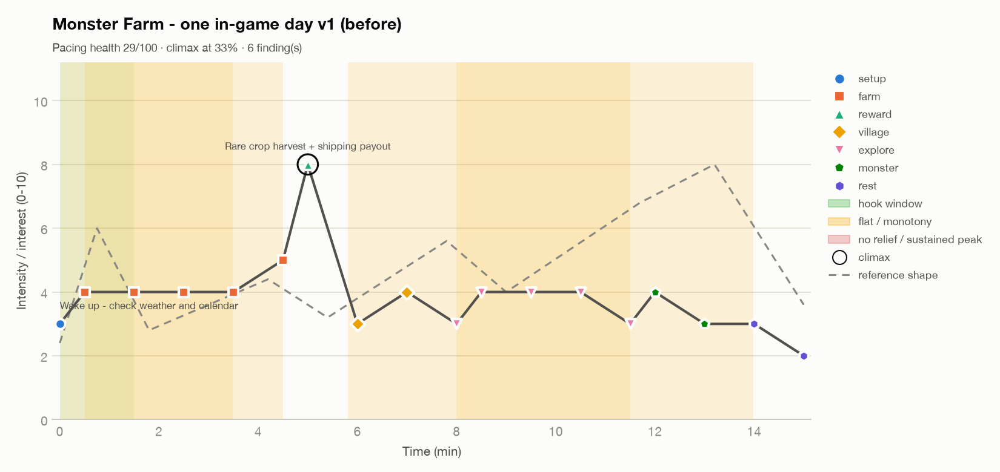
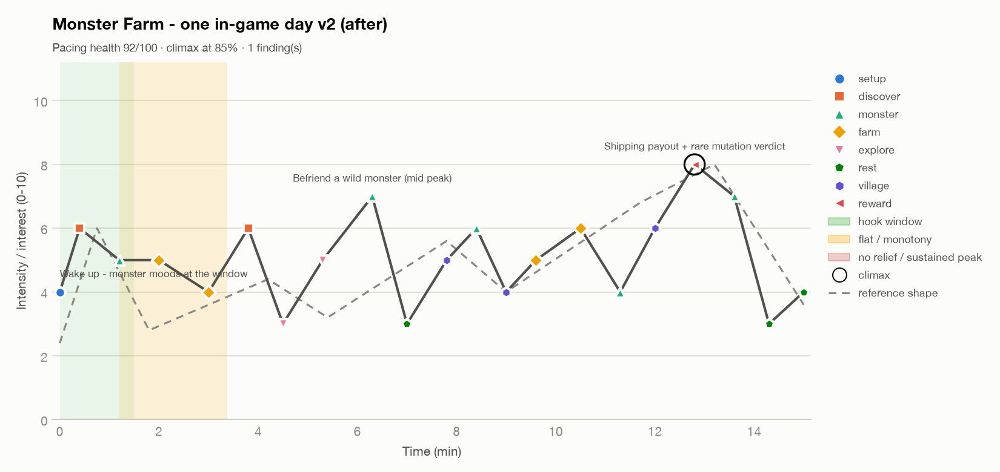

# 몬스터 팜 — 게임 속 하루 관심 곡선 (Interest Curve) 분석

> 분석 단위: **게임 속 하루 1회** (06:00~24:00 = 실시간 약 15분) · 장르: 농장 시뮬 × 몬스터 교감(힐링)
> 도구: `ai-game-designer/skills/fun-curve/scripts/fun_curve.py` (전·후 모두 같은 기본 임계값, `--reference`)
> 강도 (Intensity) 값은 기획 단계의 **예측치**입니다. 플레이테스트 실측으로 바꿔야 합니다.

## 1. 목표 모양

15분짜리 하루는 **첫 1.5분(10%) 안에 "밤사이 무슨 일이 있었지?"로 갈고리 (Hook)를 걸고**,
작은 정점과 의도된 쉼이 번갈아 오는 완만한 톱니 모양 (Sawtooth)으로 올라가다가,
**마지막 20% 안(저녁 출하 정산·교감 장면)에서 정점 (Climax)을 찍고**, 짧은 마무리와
"내일 생길 일" 예고로 끝나야 합니다.

힐링 장르라서 강도 9~10은 쓰지 않고 정점 상한을 8로 둡니다. 따라서 "고강도(≥8) 시간 0%"는
결함이 아니라 의도입니다. 임계값은 바꾸지 않고 기본값을 그대로 써서, 전후 비교가 같은 기준에서
이뤄지게 했습니다.

## 2. 수정 전 (v1) 비트 리스트 (Beat List)

농부가 하는 일을 순서대로 늘어놓은, 흔한 첫 초안입니다. 파일: `fun_curve/day_v1_before.csv`

| 시간(분) | 강도 | 유형 | 내용 |
|---|---|---|---|
| 0.0 | 3 | setup | 기상 — 날씨·달력 확인 |
| 0.5 | 4 | farm | 밭 둘러보기 |
| 1.5 | 4 | farm | 물 주기 (슬라임에게 도움 지시) |
| 2.5 | 4 | farm | 계속 물 주기 |
| 3.5 | 4 | farm | 잡초 뽑기 |
| 4.5 | 5 | farm | 수확 |
| 5.0 | 8 | reward | 희귀 작물 수확 + 출하 정산 |
| 6.0 | 3 | village | 마을로 걸어가기 |
| 7.0 | 4 | village | 씨앗 상점 |
| 8.0 | 3 | explore | 숲으로 걸어가기 |
| 8.5 / 9.5 / 10.5 | 4 | explore | 채집 ×3 |
| 11.5 | 3 | explore | 집으로 걸어가기 |
| 12.0 | 4 | monster | 몬스터 먹이 주기 |
| 13.0 | 3 | monster | 몬스터 쓰다듬기 |
| 14.0 | 3 | rest | 일기 쓰기 |
| 15.0 | 2 | rest | 잠자기 |



**곡선 읽기:** 5분에 딱 한 번 솟고 나머지 10분은 3~4 사이를 기어갑니다. 회색 점선(참고 곡선)이
올라가야 할 후반부에서 v1은 오히려 내려갑니다. 그리고 **게임의 핵심 판타지인 몬스터가 하루의
마지막 20%에, 강도 3~4로 한 번 나올 뿐**입니다. 곡선만 봐도 "몬스터 하나가 농장을 바꾼다"는
기둥이 이 하루에 없다는 게 드러납니다.

## 3. 진단 결과 (v1) — 심각도 순

스크립트 결과: **페이싱 건강도 (Pacing Health) 29/100 · 클라이맥스 33% 지점 · 발견 6건**
(원문: `fun_curve/day_v1_before_report.md`)

| # | 문제 | 심각도 | 왜 나쁜가 | 고친 방법 (v2) |
|---|---|---|---|---|
| 1 | **갈고리 없음 (Missing Hook)** — 첫 1.5분 최고 4 | HIGH | 하루를 시작할지 끌지는 첫 순간에 결정됩니다. 날씨·달력 확인은 "정보"일 뿐, 궁금증이 없습니다 | 0.4분에 **밤사이 변화 발견**(변이 싹·몬스터 발자국, 6) 삽입. 새 시스템 "밤사이 이벤트"가 필요 → 발견 기둥에 직결 |
| 2 | **이른 클라이맥스 (Early Climax)** — 출하 정산이 33% 지점 | HIGH | 사람은 정점과 끝을 가장 잘 기억합니다. 하루 최고의 보상을 정오에 써 버리면 남은 10분은 내리막입니다 | 출하 정산을 **저녁 12.8분(85%)**으로 이동(출하함은 해 질 녘에 걷어 감). 정오 자리에는 **야생 몬스터와 친해지기**(7)를 중간 정점으로 |
| 3 | **평탄 구간 (Flat Zone)** 5.8~14.0분, 평균 3.6 | HIGH | 하루의 55%가 저강도로 평평합니다. 힐링 게임의 "편안함"과 "지루함"은 다르고, 여기는 이동·반복 채집이라 지루함 쪽입니다 | 이동 비트를 **몬스터 동행 산책**(의도된 쉼, 3)으로 바꾸고, 그 뒤를 흔적 따라가기(5) → 친해지기(7) → 점심 휴식(3) → 마을 의뢰(5) → 동행 몬스터 재주(6) → 상점(4)… 으로 재구성 |
| 4 | **평탄 구간** 0.0~3.5분, 평균 3.9 | HIGH | 아침이 물 주기 반복으로 시작합니다. 몬스터가 있는데 플레이어가 물뿌리개를 듭니다 | 물 주기를 **몬스터 작업 배치**(조합 선택, 5)로 바꾸고, 3.8분에 **조합 효과 발견**(젖은 흙 + 밭갈기 = 비옥한 칸, 6) 삽입. 잡초 뽑기는 삭제(몬스터 작업으로 흡수) |
| 5 | **단조로움 (Monotony)** — farm 5연속(0.5~4.5분) | MEDIUM | 같은 동사가 이어지면 손은 움직여도 머리는 꺼집니다 | farm 사이에 monster·discover 비트를 끼움. 최대 연속 2개 |
| 6 | **단조로움** — explore 5연속(8.0~11.5분) | LOW | 걷기 → 채집 ×3 → 걷기 | 채집 1회로 압축, 나머지는 몬스터 조우·흔적 추적으로 교체 |

**설계상 추가 판단 (스크립트 밖):** v1은 마지막 비트가 "잠자기(2)"로 끝납니다. 세션은 다음
세션을 시작할 이유로 끝나야 하므로, v2는 **잠들기 전 내일 예고**(4, "밤에 비가 온대요 — 슬라임들이
들떴다")로 끝냅니다.

## 4. 수정 후 (v2) 비트 리스트

파일: `fun_curve/day_v2_after.csv`

| 시간(분) | 강도 | 유형 | 내용 | 바뀐 점 |
|---|---|---|---|---|
| 0.0 | 4 | setup | 기상 — 창밖으로 몬스터들의 기분 확인 | 날씨 대신 몬스터 |
| 0.4 | **6** | discover | **밤사이 변화 발견** (변이 싹) | 갈고리 |
| 1.2 | 5 | monster | 아침 인사 + 먹이 | 몬스터를 앞으로 |
| 2.0 | 5 | farm | 작업 배치 — 슬라임은 물, 두더지는 밭갈기 | 반복 → 선택 |
| 3.0 | 4 | farm | 몬스터가 일하는 동안 직접 파종 | |
| 3.8 | **6** | discover | **조합 효과 발견** — 비옥한 칸 | 신규 |
| 4.5 | 3 | explore | 몬스터와 숲길 산책 | 의도된 쉼 |
| 5.3 | 5 | explore | 채집 + 야생 몬스터 흔적 따라가기 | 채집 3회 → 1회 |
| 6.3 | **7** | monster | **야생 몬스터와 친해지기** (중간 정점) | 신규 |
| 7.0 | 3 | rest | 경치 보며 점심 | 정점 뒤 이완 |
| 7.8 | 5 | village | 주민 의뢰 받기 | 신규 |
| 8.4 | 6 | monster | 동행 몬스터가 아이들 앞에서 재주 | 2차 수정에서 추가 |
| 9.0 | 4 | village | 씨앗 상점 + 숲 재료 교환 | |
| 9.6 | 5 | farm | 의뢰용 작물 손질 | |
| 10.5 | 6 | farm | 오늘의 대표 작물 수확 | |
| 11.3 | 4 | monster | 목욕·빗질 (호감 게이지) | 정점 전 숨 고르기 |
| 12.0 | 6 | village | 의뢰 납품 → 레시피 해금 | |
| 12.8 | **8** | reward | **저녁 출하 정산 + 희귀 변이 작물 판정 (클라이맥스)** | 33% → 85% |
| 13.6 | 7 | monster | 호감도 단계 상승 — 새 농사 기술 습득 | 신규 |
| 14.3 | 3 | rest | 모닥불 일기 (하루 요약) | 짧은 마무리 |
| 15.0 | 4 | rest | 잠들기 전 내일 예고 | 끝을 갈고리로 |



**곡선 읽기:** 0.4분에 갈고리, 6.3분에 중간 정점과 바로 뒤의 점심 쉼, 그다음 4~6 사이의
톱니 모양을 거쳐 12.8분에 정점, 13.6분 여운 뒤 짧게 내려와 예고로 끝납니다. 세부 높낮이는
다르지만 참고 곡선의 큰 모양(초반 갈고리 → 오르는 톱니 → 후반 정점 → 짧은 마무리)을 따라갑니다.

> 차트의 유형별 색은 등장 순서로 정해지므로 두 차트에서 같은 유형의 색이 다를 수 있습니다.

## 5. 전후 비교

| 지표 | v1 (수정 전) | v2 (수정 후) | 해석 |
|---|---|---|---|
| 페이싱 건강도 (휴리스틱) | 29 / 100 | **92 / 100** | 요약 점수일 뿐 품질 측정치가 아님 |
| 발견된 문제 | 6건 (HIGH 4 · MEDIUM 1 · LOW 1) | **1건** (MEDIUM 1) | HIGH 전부 해소 |
| 갈고리 강도 (첫 10%) | 4 | **6** | 기준(≥6) 충족 |
| 클라이맥스 위치 | 5.0분 (33%) | **12.8분 (85%)** | 기준(≥70%) 충족 |
| 클라이맥스 강도 | 8 | 8 | 힐링 장르 상한 유지 |
| 평균 강도 | 3.86 | 5.13 | "편안히 몰입"(4~5) 대역 |
| 정점 수 (≥7) | 1 | 2 | 중간 정점 추가 |
| 고강도(≥8) 시간 비율 | 0% | 0% | 의도 |
| 저강도(≤3) 시간 비율 | 14% | 0.2% | 쉼은 짧은 점으로만 존재 |
| 몬스터 비트 수 / 평균 강도 | 2개 / 3.5 (하루 끝에 몰림) | **5개 / 5.8** (하루 전체에 분산) | 핵심 기둥이 곡선에 나타남 |

**반복 과정:** 1차 수정본은 HIGH를 모두 없앴지만(점수 84) MEDIUM 평탄 구간이 2개 남았습니다.
마을 구간(7.4~9.6분, 의뢰 → 상점)은 기둥과 상관없는 심부름이라 8.4분에 "동행 몬스터의 재주"를
넣어 해소했고(점수 92), 아침 구간은 아래 이유로 남겼습니다.

**남긴 문제 — 평탄 구간 1.2~3.4분 (평균 4.7, MEDIUM):** 아침 먹이 → 작업 배치 → 파종 구간입니다.
목표 미학 1순위가 소일거리 (Submission)이므로, 하루에 한 번은 손에 익은 루틴을 편하게 도는
2분이 있어야 한다고 판단해 **의도적으로 남겼습니다.** 강도 4~5는 지루함이 아니라 "편안한 몰입"
대역입니다. 다만 플레이테스트에서 이 구간에 입력 없는 시간이 길게 나오면, 몬스터의 작은
돌발 행동(물을 튀겨 옆 칸 싹이 먼저 틈, 5→6)을 넣습니다.

## 6. v2가 요구하는 기능 (범위에 반영)

곡선을 고치면 기능이 늘어납니다. 아래 4개가 v2 하루를 성립시키는 최소 기능이며
`03_one_page_gdd.md`의 범위 점검에 포함했습니다.

| 기능 | 만드는 비트 | 기둥 |
|---|---|---|
| 밤사이 이벤트 (변이 싹, 발자국, 몬스터가 옮겨 둔 물건) | 0.4 갈고리, 15.0 예고 | 눈으로 보고 알아낸다 |
| 몬스터 작업 배치 + 조합 효과 | 2.0 배치, 3.8 조합 발견 | 몬스터 하나가 농장을 바꾼다 |
| 야생 몬스터 친해지기 (먹이·흔적, 확률 없음) | 5.3 흔적, 6.3 중간 정점 | 몬스터 하나가 농장을 바꾼다 |
| 저녁 출하 정산 + 호감도 단계 연출 | 12.8 클라이맥스, 13.6 여운 | 실패는 없고 우회만 있다 (정산은 보상만, 손실 없음) |

**시계 설계 결정:** 시간은 바깥에서만 흐르고, 메뉴·대화·몬스터 교감 중에는 멈춥니다. 자정을 넘겨도
벌칙이 없습니다(자동 귀가, 손실 없음). 실시간 압박이 소일거리 미학을 깨지 않게 하기 위해서입니다.

## 7. 검증 계획

이 곡선은 예측입니다. 2주 그레이박스에서 아래를 로그로 남겨 실측 곡선으로 교체합니다.

| 무엇을 | 어떻게 | 고쳐진 것으로 볼 기준 |
|---|---|---|
| 갈고리 | 하루 시작 후 밤사이 변화 오브젝트와 첫 상호작용까지 시간 | 테스터 80% 이상이 90초 안에 상호작용 |
| 평탄·지루함 | 20초 이상 입력 없는 구간의 위치·길이, 구간별 체감 점수(1~5, 하루 끝에 회상) | 무입력 구간이 특정 시간대에 몰리지 않음, 어떤 구간도 평균 2.5 미만이 아님 |
| 클라이맥스 | 하루 끝 "오늘 제일 좋았던 순간" 질문 | 응답의 절반 이상이 저녁 정산·호감도 장면 |
| 몬스터 기둥 | 하루당 몬스터 배치 변경 횟수 | 2일차부터 하루 2회 이상(지시 없이) |
| 이탈 지점 | 게임을 끈 게임 속 시각 | 종료의 60% 이상이 취침 직후(하루 중간 이탈이 적음), 그중 절반 이상이 다음 세션에서 이어 함 |

실측 비트로 바꾼 뒤 이 폴더에서 같은 명령으로 다시 돌립니다.

```bash
python3 ../../ai-game-designer/skills/fun-curve/scripts/fun_curve.py fun_curve/day_v2_after.csv --out fun_curve --reference
```
