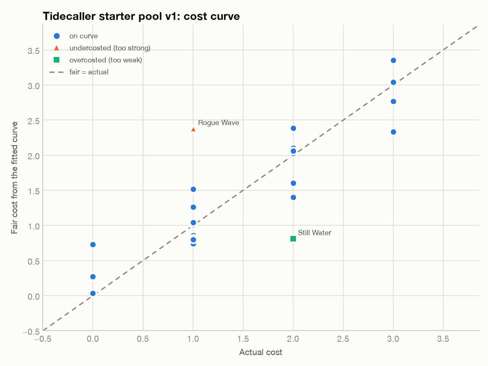
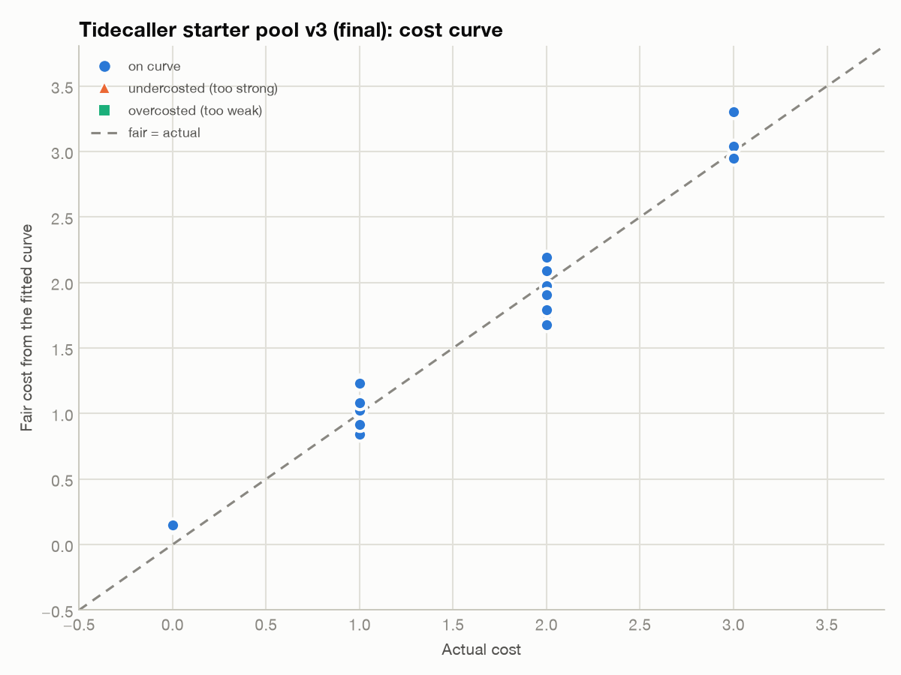

# Tidecaller: starter pool cost-curve analysis

24-card starter pool, three passes: draft (v1) → fix (v2) → model check and final (v3).
Tool: `balance-economy/scripts/cost_curve.py --robust`. It fits cost ≈ intercept + Σ weight × attribute,
leaves out |z| > 2 outliers, refits, and then judges every card against the clean curve.

## 1. Targets

| Feeling | Number |
|---|---|
| Three energy a turn, like the genre standard. A turn is "play 3–4 cards". | Costs 0–3; curve 3 / 10 / 7 / 4 cards at cost 0 / 1 / 2 / 3 |
| Basics feel weak, so the first card reward feels like an upgrade | Splash and Brace sit 0.1–0.2 below the curve |
| Moving the tide is a real resource, not free text | `tide` has a clearly positive weight |
| Neither direction dominates | Crest (tide 10) and Slack Water (tide 0) pay back about the same |
| No card is strictly better than another | No pair where card A equals card B plus a bonus at the same cost |

## 2. Model

| Variable | Meaning |
|---|---|
| `damage` | Single-target damage |
| `aoe_damage` (v3) / `aoe` 0/1 (v1–v2) | Damage to ALL enemies |
| `block` | Block gained |
| `draw` | Cards drawn |
| `tide` | How far the card moves the gauge, either direction (Surge or Ebb) |
| `drench` | Drench stacks (the target's next N hits taken deal +3) |
| `exhaust` | 1 if the card is removed after play (a drawback) |

**Assumptions:** the tide is priced the same in both directions, because both Crest and Slack Water pay off.
Conditional text, synergies and gauge position aren't priced (see Limits).

## 3. Results

### v1 draft: [`cards/tidecaller-starter-v1.csv`](cards/tidecaller-starter-v1.csv)

R² 0.71, RMSE 0.49. 

| Card | Cost | Fair | Verdict |
|---|---|---|---|
| Rogue Wave | 1 | 2.38 | **Undercosted** (14 damage for 1 energy, more than twice the rate of any other attack) |
| Still Water | 2 | 0.81 | **Overcosted** (5 block for 2) |
| Spring Tide | 0 | 0.73 | Just under the flag line (±0.74). A free Draw 2 + Surge 4 |
| Drowned Bell | 3 | 2.34 | Just under the flag line. An Exhaust AoE priced as a rare |
| Moonpull | 2 | 1.40 | Just under the flag line. The same Surge 4 / Draw 2 as Spring Tide, but costs 2 |

**The less obvious finding:** the fitted weight of `tide` was **−0.04**. The draft gave tide movement no value at all.
Spring Tide (free) and Moonpull (2 energy) both move the gauge 4 and draw 2, so their tide value cancels out.
When a core attribute fits near zero or negative, the set is pricing it inconsistently. Two cards
hide inside the threshold here because they cancel each other.

**Rules bug, separate from the numbers:** v1 Still Water read "Ebb 1. If the tide did not change this turn,
keep this block." The card moves the tide itself, so the condition could never trigger.

### v2 fixes: [`cards/tidecaller-starter-v2.csv`](cards/tidecaller-starter-v2.csv)

| Card | v1 → v2 | Why |
|---|---|---|
| Rogue Wave | cost 1 → 2 | Keeps the big-hit fantasy and pays for it |
| Spring Tide | cost 0 → 1, Draw 2 → Draw 1 | The tide engine has to cost something, or tide is worthless |
| Still Water | 5 block, Ebb 1, broken rider → **8 block, Ebb 3** | Becomes the Ebb mirror of Moonpull, and the rules bug is gone |
| Drowned Bell | cost 3 → 2 | Exhaust AoE at 3 was a dead pick |

R² rose from 0.71 to 0.94 and RMSE fell from 0.49 to 0.20. `tide` now fits at **+0.21**, so the set finally prices it.
With the tighter curve the threshold drops to the ±0.5 floor, and two cards cross it:
Rogue Wave (+0.54) and Spindrift (+0.59).

### Model check: [`cards/tidecaller-starter-v2-aoe-check.csv`](cards/tidecaller-starter-v2-aoe-check.csv)

Spindrift (4 damage to ALL, Surge 2, cost 1) looked suspicious. By genre standards a 1-cost
4-damage AoE is modest. The flat 0/1 `aoe` flag adds the same +0.82 whether the AoE does 4 damage or 12,
so low-damage AoE looks expensive and high-damage AoE looks cheap. Re-fitted with `aoe_damage` per point:

- The fit improves: R² 0.952, RMSE 0.18.
- **Spindrift moves to +0.07, on the curve.** The flag was a model artifact, so the card is **unchanged**.
- Rogue Wave stays the strongest card in both models (+0.31 / +0.54). That's a real signal.

### v3 final: [`cards/tidecaller-starter-v3.csv`](cards/tidecaller-starter-v3.csv)

| Card | v2 → v3 | Why |
|---|---|---|
| Rogue Wave | 14 → 12 damage | Strongest card in both models; trimmed |
| Crest Breaker | Surge 1 → **Ebb 1** | Design fix, not a fit fix. At 12 damage / Surge 2, Rogue Wave was Crest Breaker plus one Surge for the same cost, which on paper is strictly better. Flipping the direction removes that and gives Ebb decks a 2-cost attack |

**R² 0.96, RMSE 0.16, 0 flagged cards.** Largest residuals: Tidal Wave +0.31 (a rare, slightly above the curve
on purpose) and Drowned Bell −0.32 (watch its pick rate). 

### What one energy buys (v3 weights)

| 1 energy ≈ | |
|---|---|
| 5.9 single-target damage | weight 0.17 |
| 4.0 AoE damage | 0.25. AoE pays a 1.5× premium, so it beats single-target from 2 enemies up |
| 5.3 block | 0.19 |
| 2.1 cards drawn | 0.48 |
| 5.3 tide points | 0.19 |
| 2.8 Drench stacks | 0.36 |
| Exhaust | −0.59, so a one-shot card is worth about 0.6 energy less |
| Card baseline | −0.31, so every card gets about 0.3 energy of value free (it costs a draw) |

**Crest vs Slack Water.** Either one takes 5 tide points from the starting tide of 5. At the fitted rate that's about 0.95 energy.
Crest gives 8 AoE ≈ 2.0 energy. Slack Water gives 8 block + draw 1 ≈ 2.0 energy. **Both pay back about 2×, and they're
symmetric.** Neither direction wins on paper. Whether that holds in play is the main thing to check in testing.

## 4. Remaining risks (ranked)

1. **Position-dependent tide value.** Surge 4 at tide 6 triggers Crest, but at tide 1 it pushes you away from Slack. The linear model
   prices tide flat. *Test:* log the gauge position whenever a card is played, and look at the win rate when Crest/Slack triggered that turn.
2. **Ebb and Flow's free choice of direction** isn't priced, and flexibility is usually worth something. *Watch:* if its pick rate is above
   about 1.5× the common average, raise it to cost 1 / Draw 2 / Move 2 with Exhaust, or drop it to Draw 1.
3. **Direction skew.** Ebb now has both attacks and defense: 5 attacks (Undertow, Crest Breaker, Whirlpool, Maelstrom, Drowned Bell)
   plus every pure-block card. Surge has only one card with block (Moonpull, 3 block). After the Crest Breaker flip, Ebb also outnumbers
   Surge 13 to 10 (1 card can go either way). *Next pool:* add 2 Surge defensive cards so a Crest deck doesn't have to borrow Ebb block.
4. **Drench is linear,** but it scales with hit count. Multi-hit cards would break it. Keep multi-hits rare or cap Drench.

## 5. Validation plan

- **Telemetry per card:** pick rate when offered, win rate of decks that contain it, and play rate when drawn. These are the metrics Slay the Spire's
  team balanced with (Giovannetti, GDC 2019), and the team warned that metrics need context. Read a card's numbers next to its archetype.
- **Per run:** count of Crest vs Slack triggers and the win rate split by which one dominated. If one side passes about 65% of triggers in
  winning runs, rebalance the payoffs. That 65% is a rule of thumb, not a published threshold.
- **Playtest questions:** "Did you ever hold a card because of where the tide was?" (We want yes.) "Did any card feel like an
  automatic pick?"

## Limits

A linear cost curve misses synergies, conditional text and metagame context. These flags are things to check in playtests,
not verdicts. With 24 cards and 8 parameters the weights carry real uncertainty. Re-fit each time the pool grows.
