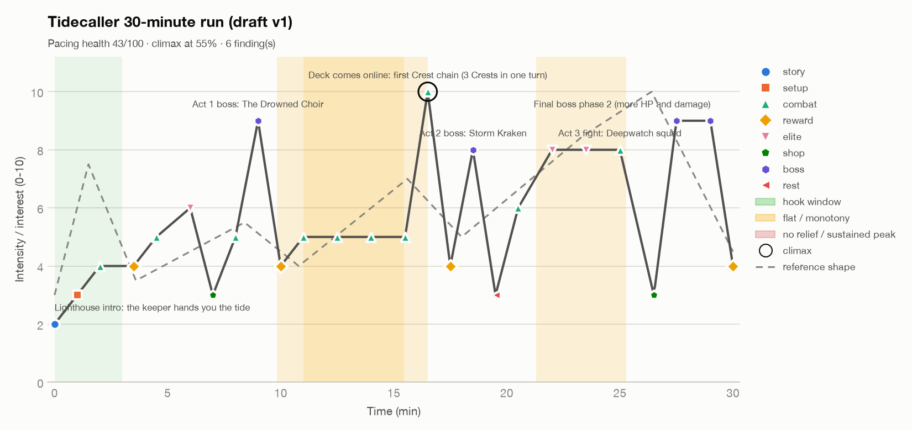
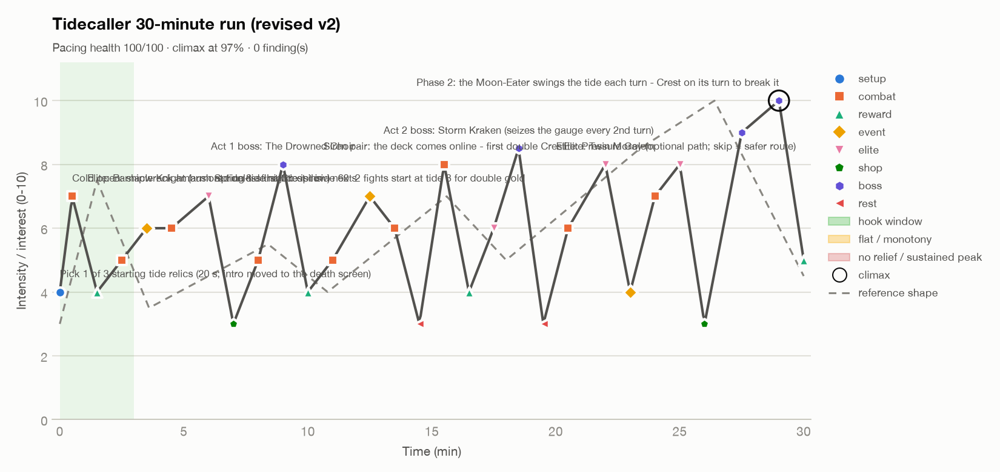

# Tidecaller: interest curve of a 30-minute run

**Scale:** one full run (3 acts + final boss), 30 minutes.
**Target shape:** hook inside the first 2 minutes. Then a sawtooth that rises across three ~10-minute acts, with shops and rests as
valleys and a deck-comes-online peak around the middle. The final boss is the highest point and sits in the last 10%, followed by a short resolution.

Tool: `fun-curve/scripts/fun_curve.py --reference`. Intensity is *felt* engagement from 0 to 10, scored on the skill's rubric:
4–5 routine fight, 6–7 elite or new twist, 8 boss, 9 final boss, 10 used once.

## Draft v1: [`run/tidecaller-run-v1.csv`](run/tidecaller-run-v1.csv)

The run as a typical first plan would lay it out: an intro, then fights, a boss per act, and a final boss with more HP.

**Read:** the run opens flat and quiet. It peaks at 16.5 min, when the first Crest chain fires, and nothing afterwards beats that moment.
Act 2 is four identical fights, and Act 3 holds at 8 for four minutes.

### Findings (ranked)

| # | Problem | Why it hurts | Beat change in v2 |
|---|---|---|---|
| 1 | **Missing hook.** The best beat in the first 3 min is 4/10 | Players decide early whether a run is worth it. A 1-min intro plus a tutorial popup spends the first 10% on reading | Cut the intro. **0.5 min: cold-open shipwreck ambush that starts at tide 8, so the first Crest fires within 60 s (7).** The lighthouse story moves to the death screen (the Hades lesson: story moves forward because you died) |
| 2 | **Early climax.** The first Crest chain (10) at 55% tops every later beat | Players remember the peak and the end best. If the highlight happens mid-run, the final boss is a letdown. v1 phase 2 was only "more HP and damage", so the numbers went up but the challenge didn't change | The deck-comes-online beat becomes **15.5 min: double Crest (8)**, still a strong peak but not the top one. **29.0 min: Moon-Eater phase 2 swings the tide every turn, and you must Crest on its turn to break it (10).** The climax tests the core skill, not your HP bar |
| 3 | **Flat zone, Act 2 (9.8–15.4 min, ~4.9).** Five back-to-back combat beats | Once the deck works, identical fights put the game on autopilot. This is the genre's classic "boring middle" | 12.5: **Spring-tide night** (opt-in risk: fights start at tide 8 for double gold, 7). 13.5: a Drench-check fight (6). 14.5: **tide-pool rest** (3) before the peak. 11.0: enemies now *Ebb* the gauge against you, so the twist changes the kind of challenge, not just the numbers |
| 4 | **High flat zone, Act 3 (21.3–25.3 min, ~7.9).** Two elites and a hard fight at 8 with no dip | Holding high intensity this long numbs players, and the final boss then reads as more of the same | 23.0: **wreck-salvage event** (4) between the elites. 25.0: the Twin Moray elite becomes an *optional* path, so the player chooses the risk. 26.0: shop + heal before the boss |
| 5 | **No escalation.** Peaks fall 9 → 10 → 8 → 8 → 9 (trend −0.9) | Bosses don't build on each other. The Act 1 boss at 9 leaves no room above it | Bosses now step **8 → 8.5 → 9 → 10**. Act 2 adds a boss that seizes the gauge every 2nd turn, which sets up the final boss mechanic |
| 6 | **Monotony.** 5 combat beats in a row (11.0–16.5) | Same node type, same decision | Fixed by #3 |

## Revised v2: [`run/tidecaller-run-v2.csv`](run/tidecaller-run-v2.csv)

| Metric | v1 | v2 |
|---|---|---|
| Findings | 6 (2 high, 3 medium, 1 low) | **0** |
| Hook strength (first 10%) | 4 | **7** (at 0.5 min) |
| Climax position | 10 at 55% | **10 at 97%** |
| Boss peaks | 9 / 8 / 9 | **8 / 8.5 / 9 → 10** |
| Time at high intensity (≥ 8) | 20% | 8% |
| Time at low intensity (≤ 3) | 4% | 0% |
| Mean intensity | 5.76 | 5.99 |
| Pacing health (heuristic) | 43 / 100 | 100 / 100 |

The pacing-health score is a summary of the rule checks, not a measure of fun. 100/100 means "no structural red flags",
nothing more. The whole curve is a **prediction**, and only playtests confirm it.

### What the tool can't see

1. **The deck-comes-online peak is emergent, not scheduled.** It fires whenever a build clicks. The levers are a removal option at the first shop (7.0),
   a rare card reward in Act 2 (16.5), and a rest-site upgrade (14.5). If it usually lands after the Act 2 boss, Act 3 is
   just cleanup. If it lands in Act 1, the rest of the run is flat.
2. **Valleys are short.** In v2 no stretch stays at ≤ 3; every valley is a single shop or rest beat. That fits a 30-min run. If testers
   report fatigue, lengthen the rest beats first (story, upgrade choice), not the fights.
3. **Run length will drift.** Fights in this genre vary from about 1 to 4 minutes. If the median run goes above about 35 min, cut one Act 3 fight
   before cutting an event or rest.

## Validation plan

| Measure | Target (rule of thumb) | What a miss means |
|---|---|---|
| Time to first Crest (run 1) | < 60 s | Hook fix not working: raise the cold-open starting tide |
| Quit points by node | No node has > 2× the median quit rate | A flat or frustrating beat. Check Act 2 first |
| Timestamp of first double Crest | Median at 45–60% of run time | Deck builds too fast or too slow: tune Act 1 rewards and removal |
| Run length | Median 28–34 min | Trim Act 3 fights first |
| Share of runs reaching Moon-Eater phase 2 | Report by difficulty tier | If the climax is rarely seen, the peak exists on paper only |
| Post-run question "best moment of the run?" | Most answers: final boss or the double Crest | If "the first fight" or "a shop" wins, the late peaks aren't landing |
| Post-run question "when were you bored?" | No cluster on one act | A cluster on Act 2 means the flat zone is back |
