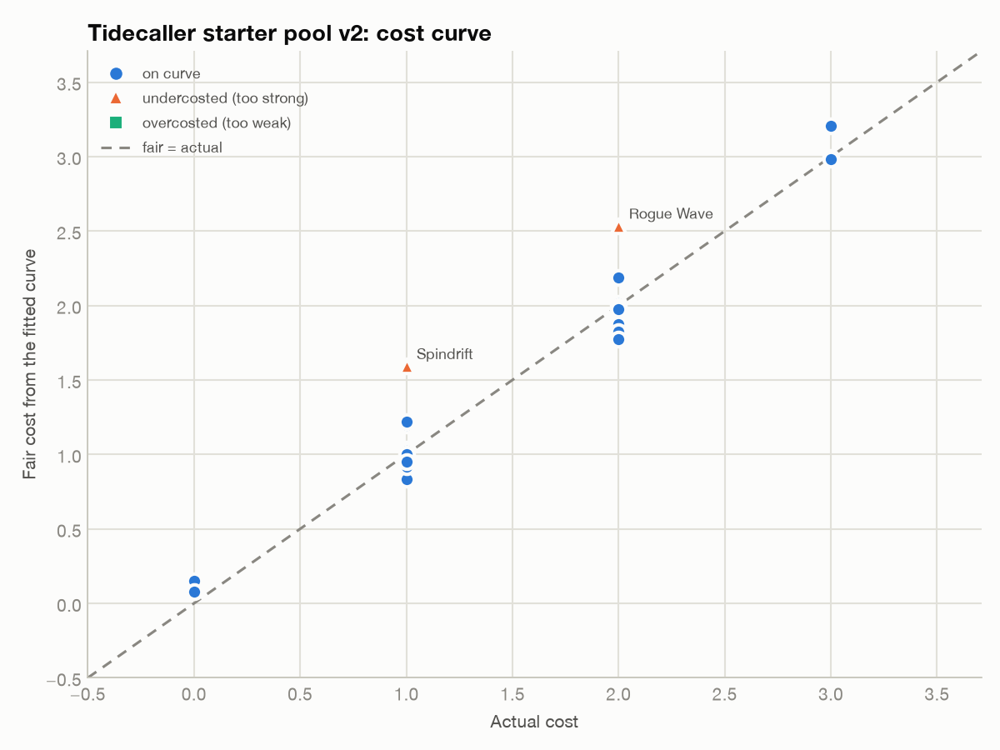

# Cost curve: Tidecaller starter pool v2: cost curve

Fit on 24 items: R² = 0.937, RMSE = 0.20 cost. Flag threshold ±0.50.

## Value of each attribute (in cost units)

| Attribute | Cost per point |
|---|---|
| (intercept) | -0.340 |
| damage | +0.176 |
| block | +0.193 |
| draw | +0.464 |
| tide | +0.206 |
| drench | +0.277 |
| aoe | +0.817 |
| exhaust | -0.593 |

_The intercept is the baseline cost every item pays (e.g. the card itself). A negative weight usually marks a drawback; if a 'positive' attribute fits negative, it is overvalued in the current set or confounded with another column._

## Outliers

- **Spindrift** costs 1, fair ≈ 1.6 (+0.6): undercosted (too strong); raise its cost or trim its stats.
- **Rogue Wave** costs 2, fair ≈ 2.5 (+0.5): undercosted (too strong); raise its cost or trim its stats.

## All items

| Item | Cost | Fair | Residual | Verdict |
|---|---|---|---|---|
| Spindrift | 1 | 1.59 | +0.59 | undercosted (too strong) |
| Rogue Wave | 2 | 2.54 | +0.54 | undercosted (too strong) |
| Mist Veil | 1 | 1.22 | +0.22 | on curve |
| Tidal Wave | 3 | 3.21 | +0.21 | on curve |
| Riptide | 1 | 1.20 | +0.20 | on curve |
| Breakwater | 2 | 2.19 | +0.19 | on curve |
| Neap Tide | 0 | 0.15 | +0.15 | on curve |
| Saltspray | 0 | 0.08 | +0.08 | on curve |
| Undertow | 1 | 1.03 | +0.03 | on curve |
| Brine Lash | 1 | 1.02 | +0.02 | on curve |
| Whirlpool | 2 | 2.02 | +0.02 | on curve |
| Ebb and Flow | 1 | 1.00 | +0.00 | on curve |
| Maelstrom | 3 | 3.00 | -0.00 | on curve |
| Moonpull | 2 | 1.99 | -0.01 | on curve |
| Abyssal Call | 3 | 2.99 | -0.01 | on curve |
| Crest Breaker | 2 | 1.98 | -0.02 | on curve |
| Spring Tide | 1 | 0.95 | -0.05 | on curve |
| Splash | 1 | 0.92 | -0.08 | on curve |
| Kelp Snare | 1 | 0.92 | -0.08 | on curve |
| Deep Current | 2 | 1.88 | -0.12 | on curve |
| Brace | 1 | 0.83 | -0.17 | on curve |
| Swell | 2 | 1.83 | -0.17 | on curve |
| Still Water | 2 | 1.83 | -0.17 | on curve |
| Drowned Bell | 2 | 1.78 | -0.22 | on curve |

_A linear cost curve misses synergies, conditional text and metagame context. Use it to find suspects, then playtest._
