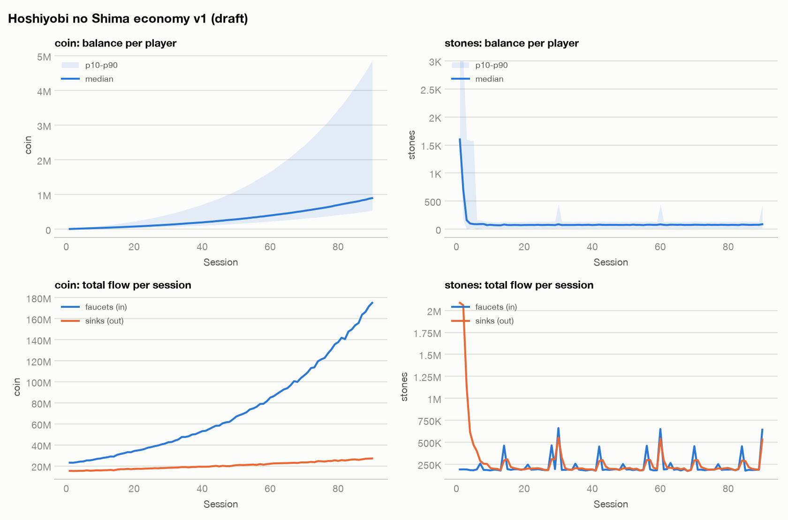
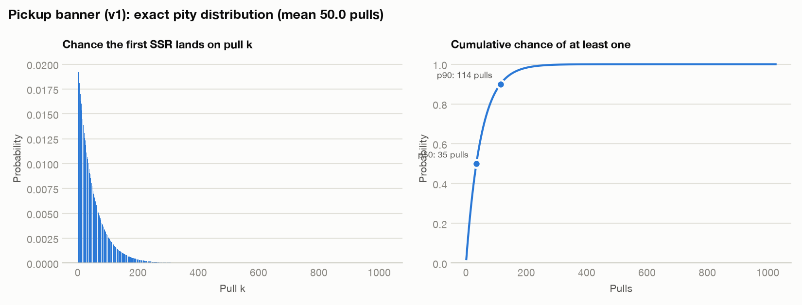

# Economy simulation: Hoshiyobi no Shima economy v1 (draft)

2,000 players × 90 sessions, seed 11.

## Findings

- **[HIGH] INFLATION (coin)**: in the last third, faucets exceed sinks 5.12:1 and the median balance keeps rising (~16,835/session; about 14.4 sessions of income hoarded). Prices tied to coin lose meaning. Fix: add sinks that scale with progression (consumables, upgrades, trade taxes) or slow late faucets.
- **[HIGH] NO_HARD_PITY**: SSR has no guaranteed ceiling; the unluckiest 1% need 228 pulls. Add a hard pity and disclose it (several jurisdictions require probability disclosure; see references/randomness-and-loot.md).

## Currency flow

| Currency | Total in | Total out | In/Out | In/Out (last third) | Median end balance | Gini |
|---|---|---|---|---|---|---|
| coin | 6,531,025,457 | 1,830,323,931 | 3.57 | 5.12 | 898,441 | 0.43 |
| stones | 20,230,268 | 25,968,450 | 0.78 | 1.00 | 86 | 0.52 |

## Archetypes

| Archetype | Players | Avg sessions | Avg upgrades | Avg pulls | Avg hits | Share with ≥1 hit | Avg spend |
|---|---|---|---|---|---|---|---|
| light_f2p | 1121 | 45.2 | 45.2 | 55.2 | 1.07 | 64% | 0.00 |
| core_f2p | 588 | 82.7 | 82.7 | 101.1 | 1.91 | 86% | 0.00 |
| monthly_pass | 203 | 81.0 | 81.0 | 130.4 | 2.53 | 88% | 1679.75 |
| dolphin | 77 | 85.9 | 85.9 | 246.1 | 4.82 | 100% | 29949.61 |
| whale | 11 | 88.7 | 88.7 | 583.5 | 12.09 | 100% | 119090.91 |

## Gacha: SSR

- Base rate 2.00%; expected pulls per SSR **50.0** (consolidated rate **2.00%**).
- Pulls needed: median 35, 90% of players by 114, 99% by 228 (no guarantee).
- Realised hit rate in the simulation: 1.93% per pull (3336 hits). It sits below the consolidated rate when most players stop before reaching soft pity.
- Players who never obtained one: 25%.

_A model, not a forecast: validate archetype assumptions against telemetry._
