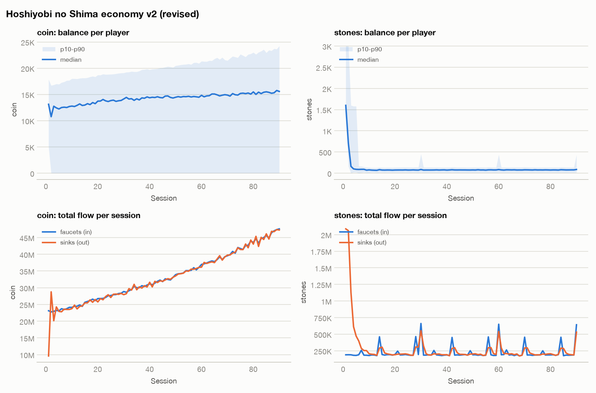
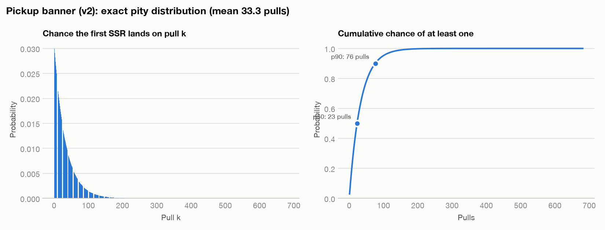

# Economy simulation: Hoshiyobi no Shima economy v2 (revised)

2,000 players × 90 sessions, seed 11.

## Findings

- **[HIGH] NO_HARD_PITY**: SSR has no guaranteed ceiling; the unluckiest 1% need 152 pulls. Add a hard pity and disclose it (several jurisdictions require probability disclosure; see references/randomness-and-loot.md).

## Currency flow

| Currency | Total in | Total out | In/Out | In/Out (last third) | Median end balance | Gini |
|---|---|---|---|---|---|---|
| coin | 3,001,187,331 | 2,981,708,666 | 1.01 | 1.00 | 15,576 | 0.31 |
| stones | 20,230,268 | 25,968,450 | 0.78 | 1.00 | 86 | 0.52 |

## Archetypes

| Archetype | Players | Avg sessions | Avg upgrades | Avg pulls | Avg hits | Share with ≥1 hit | Avg spend |
|---|---|---|---|---|---|---|---|
| light_f2p | 1121 | 45.2 | 39.7 | 55.2 | 1.58 | 80% | 0.00 |
| core_f2p | 588 | 82.7 | 94.0 | 101.1 | 2.96 | 95% | 0.00 |
| monthly_pass | 203 | 81.0 | 91.9 | 130.4 | 3.91 | 97% | 1679.75 |
| dolphin | 77 | 85.9 | 97.3 | 246.1 | 7.21 | 100% | 29949.61 |
| whale | 11 | 88.7 | 100.0 | 583.5 | 18.00 | 100% | 119090.91 |

## Gacha: SSR

- Base rate 3.00%; expected pulls per SSR **33.3** (consolidated rate **3.00%**).
- Pulls needed: median 23, 90% of players by 76, 99% by 152 (no guarantee).
- Realised hit rate in the simulation: 2.92% per pull (5060 hits). It sits below the consolidated rate when most players stop before reaching soft pity.
- Players who never obtained one: 13%.

_A model, not a forecast: validate archetype assumptions against telemetry._
