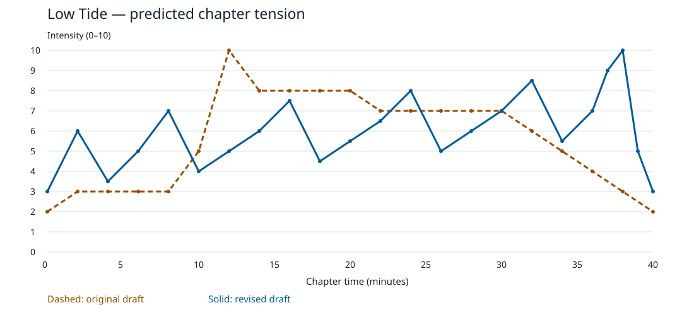

# Low Tide — chapter design and pacing revision

Status: draft for prototype. Owner: chapter design lead (role). Updated: 2026-10-30.

## Target and assumptions

A 40-minute horror chapter should hook through uncanny unease within four minutes, alternate purposeful dread with short threat spikes and protected relief, and peak during the final escape before a brief aftermath.

Assumptions: single-player, first-person, PC and console; no combat; one pursuing drowned keeper; player arrives to restart a rescue beacon and discovers it calls the dead. Forty minutes is the nominal first successful playthrough, excluding pauses, optional reading and retries. Accessibility assists can extend duration. This is an authored design exercise, not an analysis of an existing build or measured players. The initial draft is retained honestly as the first planning pass; it is not a historical production baseline.

Pillars: water continually changes familiar routes; readable rules make vulnerability fair; silence and recovered human details give threats emotional weight. Core loop: observe water and keeper → manipulate sluice/pump/lens → cross a changed space → recover a clue and plan the next move.

## Beat lists and charts

Full original beat table: [original report](analysis/beats_before_report.md). Full revised beat table: [revised report](analysis/beats_after_report.md). Editable inputs: [original CSV](beats_before.csv), [revised CSV](beats_after.csv). Times are minute marks; intensity is predicted felt tension/engagement on a 0–10 scale. The first and final rows are boundary samples, not additional duration. Between marks, build or release toward the next sample; the analyzer interpolates linearly.

## Fixes against every detected finding

| Priority / original finding | Why it matters | Implemented change and predicted intensity |
|---|---|---|
| High: MISSING_HOOK | An eight-minute administrative opening delays the horror promise. | At 2 min, the disconnected radio anticipates the player's words (6); establish a mystery rather than a mandatory jump scare. |
| High: EARLY_CLIMAX at 12 min | A 10/10 first pursuit leaves no emotional room for the ending. | Replace it with a learned pump bypass at 12 min (5); reserve 10 for severing the beacon-lit tether at 38 min. |
| High: FLAT_ZONE at 0–8 min | Searching and backtracking offer little changing meaning. | Quay at 0 (3), radio at 2 (6), safe pump lesson at 4 (3.5), footprints at 6 (5), first observed patrol at 8 (7). Remove key-fetch return trip. |
| Medium: SUSTAINED_PEAK at 11.3–20 min | Prolonged danger prevents anticipation from rebuilding. | Pump at 12 (5), harness reveal at 14 (6), gallery stealth at 16 (7.5), protected chart-room scene at 18 (4.5). |
| Medium: FLAT_ZONE at 13–20 min | Repeated pursuit makes the keeper predictable and exhausting. | Replace pursuit repetitions with spatial revelation and a single gallery crossing; lock the chart room against pursuit. |
| Medium: NO_ESCALATION | Later dangers repeat or diminish the opening threat. | Escalate major peaks at 8 (7), 16 (7.5), 24 (8), 32 (8.5), 38 (10). Progress from observation to altered terrain to combining learned systems. |
| Medium: NO_RELIEF after 20 min | A puzzle under uninterrupted pursuit cannot act as recovery. | At 20 use chart/lens planning (5.5), then climb at 22 (6.5). The preceding peak at 16 drops to 4.5 at 18. |
| Medium: FLAT_ZONE at 20.1–30.1 min | Four valve banks change location without changing decisions. | Chart routing at 20 (5.5), stair investigation at 22 (6.5), sluice escape at 24 (8), winch refuge at 26 (5), shutter practice at 28 (6), lens stealth at 30 (7). |
| Medium: NO_RELIEF after 30 min | Late pressure weakens the last chase's contrast. | Peak at 32 (8.5) is followed by a sheltered roof landing at 34 (5.5); final signal begins at 36 (7). |
| Low: MONOTONY, five explore beats at 0–8 | Opening contains no active application or revelation. | Interleave radio story and safe manipulation; remove repeat navigation. |
| Low: MONOTONY, five chase beats at 12–20 | Constant running erases choices about when to move. | Replace with puzzle, exploration, stealth and story; the keeper now has readable search behavior. |
| Low: MONOTONY, four puzzle beats at 22–28 | Identical valve inputs produce chore fatigue. | Mix route reading, one short chase and shelter; lens shutter changes spatial visibility rather than repeating a valve code. |

All changes preserve the 40-minute target. This is a redistribution of activities and stakes, not just relabeling identical rooms.

## Revised playable sequence

| Window (min; design target) | Player task and dramatic turn | Fairness, recovery and implementation |
|---|---|---|
| 0–4 | Enter the tide-marked quay; hear/see the impossible radio reply; learn a bypass on a powerless model. | No lethal threat. Show the exit tether and rescue call sign format for later use. |
| 4–10 | Track footprints into intake; observe keeper; divert water and shut sluice. | Patrol demonstrated before player exposure. Critical tells have captions and visual direction cues. Alcove latch visibly blocks the keeper. |
| 10–18 | Pump lowers water and reveals chained rescue harnesses; cross gallery above a searching keeper. | Bypass uses the safe lesson. No arbitrary oxygen timer. Chart-room door becomes a protected release point. |
| 18–26 | Discover beacon's purpose; use chart to select a living rescue signal; stair collapses; cut pursuit with a sluice. | Journal stores signal. Clear traversal route; no new chase input. Winch room is secure and saves progress. |
| 26–34 | Practice lens shutter; manipulate visibility while keeper circles lens; release counterweight to trap hatch. | Teach shutter without pursuit first. Hatch remains pinned throughout the short landing recovery; no ambient ambush rolls. |
| 34–40 | Redirect beam; follow known tether; sever it to escape the surge; radio rescue and a named crew memorial close the chapter. | No new mechanic at climax. Generous interaction target, one press to cut, no mash. Final two minutes resolve action and emotion. |

Keeper cannot enter the latched alcove, chart room or winch room. The roof landing is protected only until the player deliberately opens the marked roof exit; no countdown consumes reading time. Do not stack extra scares into these valleys. At the climax, the beam/tether connection is established visually and in journal text before a timed decision is required.

Checkpoint on entry to protected rooms at approximately 10, 18 and 26 min, and on the landing at 34 min, plus a final-escape checkpoint before the 37 min breach. Retrying restores route state, settings and solved puzzles; do not require re-listening to exposition. Initial retry budget target: no more than 2 min of replay per failure. Pause freezes threat, water and timers; suspend preserves progress.

## Analysis method and limits

Run commands and exact thresholds are in [reproduce.md](reproduce.md). Both runs use unchanged default thresholds. In this horror chapter the defaults are useful conservative checks: quiet dread still scores 4–6 when the player is anticipating a threat. We did not relax checks to obtain a clean report. The generic reference overlay option belongs to the analyzer, not a validated horror template.

The score rises from 0 to 100 because 12 weighted findings become zero; a clamped zero is not proof that the draft is worthless. High-intensity share falls from 21.9% to 7.7%, while mean predicted engagement rises from 5.69 to 5.99. The revised curve may still feel too busy or too brief at peaks. Its very low ≤3 share (0.5%) does not imply no relief: recovery occurs at 4–5.5 amid unresolved mystery. Test whether those valleys actually let players recover.

## Validation plan

Prototype with at least 8 first-time players as an initial qualitative target, including d/Deaf or hard-of-hearing players, players with motor access needs, low-vision players and players using reduced-motion settings. Recruit sensory-sensitive players using appropriately reviewed footage and informed choice; never deliberately expose them to untested flashes. This sample is for finding problems, not statistical claims.

Log consented beat entry/exit times, active play duration separately from pause/retry time, deaths, checkpoint reloads, abandoned segments, hint use and input mode. Collect optional accessibility setting data only with consent; do not infer diagnoses. Ask for retrospective tension and perceived safety at each major beat after play rather than interrupting every scare.

Prototype acceptance targets (proposed, not measured): most players identify the radio mystery by 4 min; median active first-clear duration is 36–44 min; players report reduced tension after the four protected releases; the 37–38 min escape is the most frequently named peak; no participant is blocked by a required cue or input in the tested access configurations. Check both default and assisted experiences. Record any cue failure as a defect even if overall duration is in range. If valleys remain stressful, extend their protected time and cut repeated traversal to retain scope. If the final cut is confusing, reinforce the tether lesson rather than increasing pursuit speed.

Change log: 2026-10-30 — authored initial draft, ran diagnosis, revised beats, reran unchanged checks; added chapter-specific access and validation requirements.
