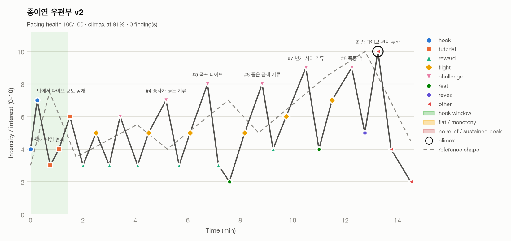

# 15분 플레이 비트와 관심 곡선

- 비트 시트: `data/beats_v1.csv` (초안) → **`data/beats_v2.csv`** (수정본)
- 진단 도구: game-designer 플러그인의 `fun_curve.py`(후킹·평탄 구간·이완 없는 피크·이른 클라이맥스·피크 상승 여부 검사)
- 결과: `out/beats_v1_report.md`, `out/beats_v1_curve.png` / `out/beats_v2_report.md`, `out/beats_v2_curve.png`

```
python3 <ai-game-designer>/plugins/game-designer/skills/fun-curve/scripts/fun_curve.py \
  data/beats_v2.csv --out out --title "종이연 우편부 v2" --reference
```

## v1 진단: 페이싱 건강도 38/100


| 심각도 | 문제 | 구간 | 원인 |
|---|---|---|---|
| HIGH | 후킹 없음 | 0~1.5분 | 첫 1.5분 최고 강도가 3. 타이틀 → 대사 → 조작 설명 텍스트로 시작함 |
| HIGH | 낮고 평탄함 | 1.2~3.2분 | #1·#2 비행과 배달이 모두 4. 튜토리얼이 그냥 이어지기만 함 |
| MED | 평탄함 | 3.2~8.1분 | #3~#5가 모두 5. 배달마다 새로운 것이 없음 |
| MED | 평탄함 | 8.2~10.2분 | #6~#7 진입부가 6 근처에 머무름 |
| MED | 고강도가 이어짐 + 평탄함 | 12~14.5분 | 폭풍 → 도착 → 엔딩 → 크레딧까지 8~9가 2.5분 동안 계속됨. 마무리가 없음 |

정리하면 **"계속 오르기만 하는 비탈"**이다. 처음에 약속하는 장면도, 중간의 대비도, 끝의 마무리도 없다.

## 고친 내용

1. **처음 15초 안에 판타지를 보여 준다**: 우체국 탑에서 바람에 날아간 편지를 쫓아 다이브하고, 구름을 뚫으면서 군도 전체가 보인다(7). 조작 설명 텍스트를 없애고, 해 보면서 배우는 힌트로 바꿨다. 이 다이브는 엔딩의 마지막 다이브와 짝을 이룬다.
2. **배달마다 장면 하나를 바꾼다**(평탄 구간 해소). 피크의 *종류*가 매번 다르다.
   - #1 첫 선회(공간) · #3 종이 울리기 전 도착(시간) · #4 풍차가 끊는 기류(리듬) · #5 폭포 따라 섬 아래로(수직) · #6 좁은 금색 기류(정밀) · #7 번개(위협) · #8 폭풍 벽 + 뒷바람(속도)
3. **배달 = 이완.** 배달할 때마다 받는 사람의 반응이 3~4로 강도를 내려 준다. 기둥 ③ "한 사람의 얼굴"이 페이싱 장치 역할도 한다.
4. **7:35에 쉬어 가는 구간 하나**(2): 우체국으로 돌아와 연 꼬리를 해금하고, 하늘이 한낮에서 폭풍색으로 바뀌기 직전의 정적. 후반 상승을 준비하는 구간이다.
5. **피크를 7 → 7 → 8 → 8 → 9 → 9 → 10으로 계속 올린다.** 배달 테이블의 난이도 계단과 1:1로 맞췄다(여분 기류 0개인 #5·#7이 각 단계의 정점).
6. **클라이맥스 앞에 한 번 비운다**: 폭풍의 눈(5)에서 고요해진 다음 노을 속 최종 다이브(10). 그 뒤에는 반전("편지는 우편부 자신에게", 4)과 자유 비행 크레딧(2)으로 마무리한다.

## v2 결과: 페이싱 건강도 100/100, 문제 0건



| 지표 | v1 | v2 |
|---|---|---|
| 건강도 | 38 | **100** |
| 후킹 강도 | 3 | **7** (0:15) |
| 피크 수 | 1 | **7** (계속 상승) |
| 클라이맥스 위치 | 94% (끝까지 이어짐) | **91%** + 마무리 |
| 고강도 시간 비율 | 17% | 9% |

## 휴리스틱이 못 보는 위험

- **톱니가 너무 규칙적이다**: 2~7분에는 "비행 → 피크 → 배달 이완"이 70~90초마다 반복된다. 스크립트는 통과했지만, 같은 모양이 다섯 번 나오면 메트로놈처럼 느껴질 수 있다. 피크의 종류를 매번 바꾼 것이 1차 대응이다. 플레이테스트에서 #4~#5 사이에 지루하다는 반응이 나오면, #4 배달 반응을 생략하고 #5로 바로 이어지는 연속 배달("편지 두 장")로 묶는다.
- **강도 숫자는 기획자의 추정이다.** 그레이박스 테스트(`01_game_brief.md` §5) 때 30초마다 1~5 체감 점수를 받아서 이 CSV 형식으로 넣고 다시 돌려 보는 것이 진짜 검증이다.
