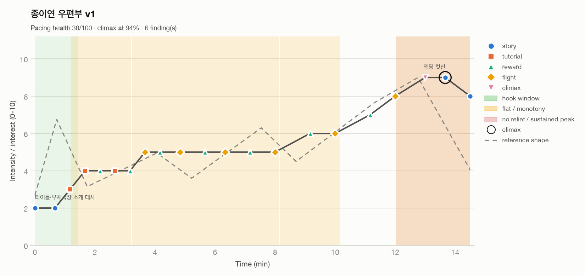

# Interest curve report: 종이연 우편부 v1

| Metric | Value |
|---|---|
| Duration | 14.5 min |
| Beats | 21 |
| Mean intensity | 5.59 / 10 |
| Peaks (≥ threshold) | 1 |
| Climax | 9 at 13.6667 min (94% through) |
| Hook strength | 3 / 10 |
| Time at high intensity | 17% |
| Time at low intensity | 8% |
| Pacing health (heuristic) | 38 / 100 |



## Findings

- **[HIGH] MISSING_HOOK** (0.0-1.5 min): No beat reaches 6/10 in the first 10% of the experience (best is 3). Players decide early whether to keep going.
  - Fix: Open with a short, legible high-interest moment (a promise of the core fantasy, a striking reveal, or a quick win), then dip to teach.
- **[HIGH] FLAT_ZONE** (1.2-3.2 min): 1.2-3.2: intensity stays within ±0.5 around 3.9 for 2.0 units (low and flat: boredom and quit risk).
  - Fix: Insert a contrast beat: a twist on the current mechanic, a new threat, a reveal, a reward, or a deliberate rest that sets up the next rise.
- **[MEDIUM] FLAT_ZONE** (3.2-8.1 min): 3.2-8.1: intensity stays within ±0.5 around 5.0 for 4.9 units (flat: interest stops moving).
  - Fix: Insert a contrast beat: a twist on the current mechanic, a new threat, a reveal, a reward, or a deliberate rest that sets up the next rise.
- **[MEDIUM] FLAT_ZONE** (8.2-10.2 min): 8.2-10.2: intensity stays within ±0.5 around 5.8 for 2.0 units (flat: interest stops moving).
  - Fix: Insert a contrast beat: a twist on the current mechanic, a new threat, a reveal, a reward, or a deliberate rest that sets up the next rise.
- **[MEDIUM] FLAT_ZONE** (12.0-14.5 min): 12.0-14.5: intensity stays within ±0.5 around 8.6 for 2.5 units (high and flat: numbness and fatigue risk).
  - Fix: Insert a contrast beat: a twist on the current mechanic, a new threat, a reveal, a reward, or a deliberate rest that sets up the next rise.
- **[MEDIUM] SUSTAINED_PEAK** (12.0-14.5 min): 12.0-14.5: intensity stays at or above 8 for 2.5 units (17% of the run).
  - Fix: Break the plateau into two peaks with a short release between them, or vary the kind of intensity (spatial, cognitive, emotional).

## Curve (text view)

```
 10 |                                                                
  9 |                                                       ·o··o··  
  8 |                                                   ·o··       ·o
  7 |                                              ···o·             
  6 |                                      ··o··o··                  
  5 |               ·o·o··o···o··o··o···o··                          
  4 |       o·o··o·o                                                 
  3 |     o·                                                         
  2 |o··o·                                                           
  1 |                                                                
  0 |                                                                
    +----------------------------------------------------------------
     0.0                                                         14.5
```

## Beats

| Time (min) | Intensity | Type | Label |
|---|---|---|---|
| 0 | 2 | story | 타이틀·우체국장 소개 대사 |
| 0.666667 | 2 | story | 우편부 임명·조작 설명 텍스트 |
| 1.16667 | 3 | tutorial | 발사대 첫 이륙 |
| 1.66667 | 4 | tutorial | #1 첫 상승기류 |
| 2.16667 | 4 | reward | #1 등대지기 배달 |
| 2.66667 | 4 | tutorial | #2 빵집 섬 비행 |
| 3.16667 | 4 | reward | #2 배달 |
| 3.66667 | 5 | flight | #3 종탑 타임어택 시작 |
| 4.16667 | 5 | reward | #3 배달 |
| 4.83333 | 5 | flight | #4 풍차 군도 |
| 5.66667 | 5 | reward | #4 배달 |
| 6.33333 | 5 | flight | #5 폭포섬 |
| 7.16667 | 5 | reward | #5 배달 |
| 8 | 5 | flight | #6 구름 다리 |
| 9.16667 | 6 | reward | #6 배달 |
| 10 | 6 | flight | #7 폭풍 전선 진입 |
| 11.1667 | 7 | reward | #7 배달 |
| 12 | 8 | flight | #8 폭풍 돌파 |
| 13 | 9 | climax | 하늘 우체국 도착 |
| 13.6667 | 9 | story | 엔딩 컷신 |
| 14.5 | 8 | story | 크레딧 |

_Heuristic diagnostics. Thresholds are configurable; confirm with playtest data (quit points, session length, observed affect)._
