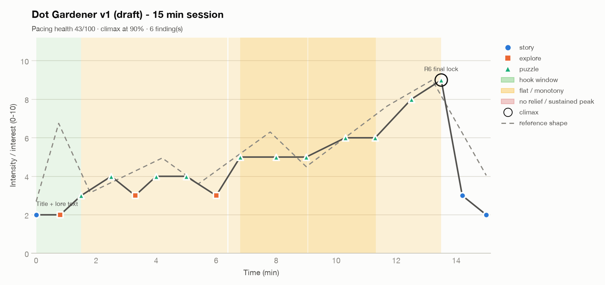

# Interest curve report: Dot Gardener v1 (draft) - 15 min session

| Metric | Value |
|---|---|
| Duration | 15.0 min |
| Beats | 17 |
| Mean intensity | 4.66 / 10 |
| Peaks (≥ threshold) | 1 |
| Climax | 9 at 13.5 min (90% through) |
| Hook strength | 3 / 10 |
| Time at high intensity | 8% |
| Time at low intensity | 16% |
| Pacing health (heuristic) | 43 / 100 |



## Findings

- **[HIGH] MISSING_HOOK** (0.0-1.5 min): No beat reaches 6/10 in the first 10% of the experience (best is 3). Players decide early whether to keep going.
  - Fix: Open with a short, legible high-interest moment (a promise of the core fantasy, a striking reveal, or a quick win), then dip to teach.
- **[HIGH] FLAT_ZONE** (1.5-6.4 min): 1.5-6.4: intensity stays within ±0.5 around 3.6 for 4.9 units (low and flat: boredom and quit risk).
  - Fix: Insert a contrast beat: a twist on the current mechanic, a new threat, a reveal, a reward, or a deliberate rest that sets up the next rise.
- **[MEDIUM] FLAT_ZONE** (6.4-9.0 min): 6.4-9.0: intensity stays within ±0.5 around 4.9 for 2.6 units (flat: interest stops moving).
  - Fix: Insert a contrast beat: a twist on the current mechanic, a new threat, a reveal, a reward, or a deliberate rest that sets up the next rise.
- **[MEDIUM] MONOTONY** (6.8-13.5 min): 7 consecutive 'puzzle' beats from 6.8 to 13.5.
  - Fix: Interleave a different activity or change the rules of the repeated one.
- **[MEDIUM] FLAT_ZONE** (9.1-11.3 min): 9.1-11.3: intensity stays within ±0.5 around 5.7 for 2.2 units (flat: interest stops moving).
  - Fix: Insert a contrast beat: a twist on the current mechanic, a new threat, a reveal, a reward, or a deliberate rest that sets up the next rise.
- **[LOW] LOW_VARIETY**: 'puzzle' makes up 65% of beats.
  - Fix: Check that the dominant activity has internal variety (enemy mixes, rule twists).

## Curve (text view)

```
 10 |                                                                
  9 |                                                       ··o      
  8 |                                                    o··  ·      
  7 |                                                 ···            
  6 |                                         ··o···o·         ·     
  5 |                            ·o····o···o··                       
  4 |         ·o··   ·o···o··   ·                               ·    
  3 |     ·o··    ·o·        ·o·                                 o·  
  2 |o··o·                                                         ·o
  1 |                                                                
  0 |                                                                
    +----------------------------------------------------------------
     0.0                                                         15.0
```

## Beats

| Time (min) | Intensity | Type | Label |
|---|---|---|---|
| 0 | 2 | story | Title + lore text |
| 0.8 | 2 | explore | Walk courtyard / control tips |
| 1.5 | 3 | puzzle | R1 plant seed - vine grows |
| 2.5 | 4 | puzzle | R1 vine bridge over moat |
| 3.3 | 3 | explore | Corridor |
| 4 | 4 | puzzle | R2 mushroom bounce up ledge |
| 5 | 4 | puzzle | R2 two mushrooms chain |
| 6 | 3 | explore | Corridor |
| 6.8 | 5 | puzzle | R3 sunflower lights dark room |
| 8 | 5 | puzzle | R3 light radius reveals floor |
| 9 | 5 | puzzle | R4 vine + mushroom |
| 10.3 | 6 | puzzle | R4 variation |
| 11.3 | 6 | puzzle | R5 light + vine |
| 12.5 | 8 | puzzle | R6 all three |
| 13.5 | 9 | puzzle | R6 final lock |
| 14.2 | 3 | story | Epilogue |
| 15 | 2 | story | Credits |

_Heuristic diagnostics. Thresholds are configurable; confirm with playtest data (quit points, session length, observed affect)._
