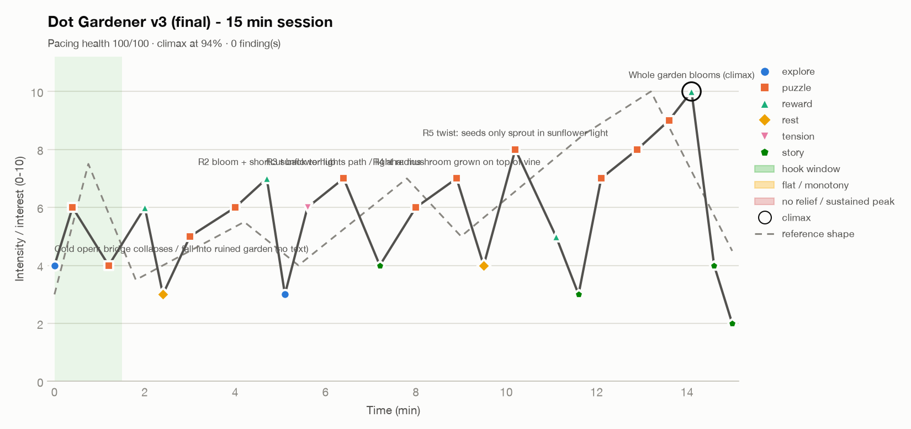

# Interest curve report: Dot Gardener v3 (final) - 15 min session

| Metric | Value |
|---|---|
| Duration | 15.0 min |
| Beats | 24 |
| Mean intensity | 5.81 / 10 |
| Peaks (≥ threshold) | 5 |
| Climax | 10 at 14.1 min (94% through) |
| Hook strength | 6 / 10 |
| Time at high intensity | 10% |
| Time at low intensity | 2% |
| Pacing health (heuristic) | 100 / 100 |



## Findings

No pacing problems detected by the heuristics. Validate with playtests.


## Curve (text view)

```
 10 |                                                           o    
  9 |                                                        ·o·     
  8 |                                           o         ·o·    ·   
  7 |                   ·o     ·o        ·o    · ·      o·           
  6 |  o     o      ··o· ·   o·  ·    ·o·  ·      ··                 
  5 | · ·· ·· ·   o·        ·     ·  ·      · ·     o  ·          ·  
  4 |o    o     ··        ··       o·        o       ··           o  
  3 |          o          o                           o            · 
  2 |                                                               o
  1 |                                                                
  0 |                                                                
    +----------------------------------------------------------------
     0.0                                                         15.0
```

## Beats

| Time (min) | Intensity | Type | Label |
|---|---|---|---|
| 0 | 4 | explore | Cold open: bridge collapses / fall into ruined garden (no text) |
| 0.4 | 6 | puzzle | R1 first seed: vine shoots across moat (hook) |
| 1.2 | 4 | puzzle | R1 aim vine direction: safe wrong try (calm) |
| 2 | 6 | reward | R1 bloom: color returns to room + gate opens |
| 2.4 | 3 | rest | Corridor: mural hints at mushroom |
| 3 | 5 | puzzle | R2 mushroom bounce up ledge |
| 4 | 6 | puzzle | R2 bounce chain + vine back-path |
| 4.7 | 7 | reward | R2 bloom + shortcut back to hub |
| 5.1 | 3 | explore | Darkening corridor: light fades |
| 5.6 | 6 | tension | R3 darkness: unseen holes / shadow bugs flee light |
| 6.4 | 7 | puzzle | R3 sunflower lights path / light radius |
| 7.2 | 4 | story | R3 bloom + gardener diary page |
| 8 | 6 | puzzle | R4 vine + mushroom: bounce onto bridge mid-air |
| 8.9 | 7 | puzzle | R4 aha: mushroom grown on top of vine |
| 9.5 | 4 | rest | Vista: whole garden half revived / central tree visible |
| 10.2 | 8 | puzzle | R5 twist: seeds only sprout in sunflower light |
| 11.1 | 5 | reward | R5 bloom: sunflower turns to follow player |
| 11.6 | 3 | story | Quiet approach to the heart of the garden |
| 12.1 | 7 | puzzle | R6 part1: light + vine |
| 12.9 | 8 | puzzle | R6 part2: uproot and replant (seed limit 3) |
| 13.6 | 9 | puzzle | R6 final chain: bounce - vine - light |
| 14.1 | 10 | reward | Whole garden blooms (climax) |
| 14.6 | 4 | story | Epilogue: gardener sits under tree |
| 15 | 2 | story | End card |

_Heuristic diagnostics. Thresholds are configurable; confirm with playtest data (quit points, session length, observed affect)._
