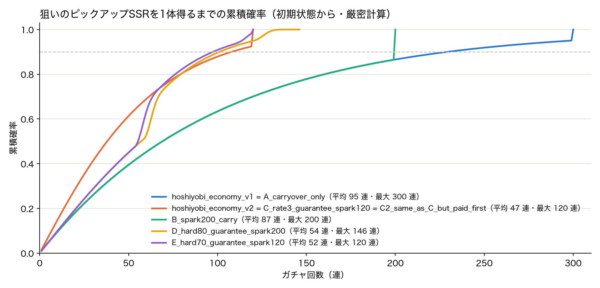
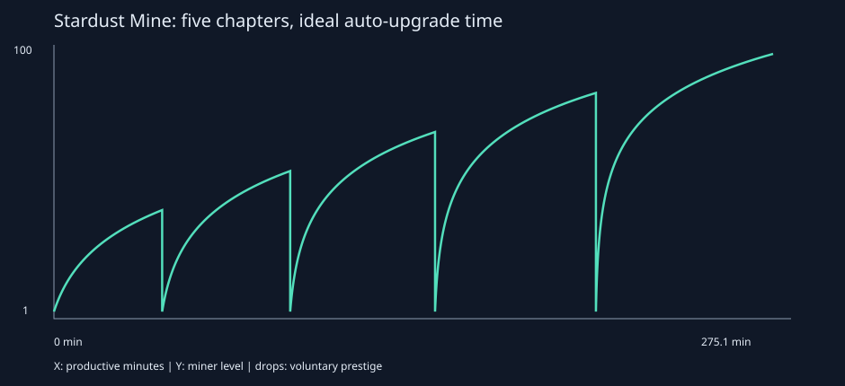

# Showcase: six real sessions, three agents, five languages

We installed the skills the way a user would and ran **six design sessions in parallel**,
each in a fresh project folder with an original game concept and a prompt in the user's
language. Every output file was written by the agent during its session. We only rewrote
local file paths as relative links, left out session plumbing (installed skills, raw logs,
caches) and session 05's `scratch/` folder (which the agent itself tried to delete), and added
`session.md`.

- **Claude Code** sessions loaded the plugin with `--plugin-dir`.
- **Codex** and **Antigravity** sessions read the skills from the project's `.agents/skills/`,
  installed with `./install.sh`.

| # | Agent (model) | Language | Concept | Skills used | Time · cost | Headline result |
|---|---|---|---|---|---|---|
| [01](01-claude-ko-monster-farm/) | Claude Code (Opus 5.5) | 한국어 | *Monster Farm*: cozy farming with monsters | game-design, fun-curve, gdd-art-direction | 7.8 min · $2.09 | Day curve pacing 29 → 92; the day's peak moved from 33% to 85%; one-pager with a scope check |
| [02](02-claude-en-deckbuilder/) | Claude Code (Opus 5.5) | English | *Tidecaller*: roguelike deckbuilder of tide spells | genre-design, balance-economy, fun-curve | 9.2 min · $2.32 | Cost-curve R² 0.71 → 0.96 with 0 off-curve cards; run curve 6 findings → 0 |
| [03](03-claude-ja-gacha-review/) | Claude Code (Opus 5.5) | 日本語 | *Hoshiyobi Island*: F2P monster-collecting RPG | balance-economy, design-review | 14.6 min · $3.86 | Coin inflation 5.12:1 → 1.00; featured SSR worst case 300 → 120 pulls; 12-issue monetization review |
| [04](04-codex-en-horror-lighthouse/) | Codex CLI (gpt-6.1-sol) | English | *Low Tide*: 40-min horror chapter in a flooded lighthouse | fun-curve, gdd-art-direction | 5.3 min · 49k tokens | Pacing findings 12 → 0; climax moved from minute 12 to 38; accessibility checklist |
| [05](05-agy-es-garden-td/) | Antigravity (Gemini 3.8 Flash) | Español | *Jardín de Guardianes*: garden tower defense | genre-design, balance-economy | 11.4 min | 30-level tower progression (24.9 h, slowest level 92 min); 2 mis-costed towers rebalanced (R² 0.999) |
| [06](06-codex-zh-idle-mining/) | Codex CLI (gpt-6.1-sol) | 中文 | *星尘矿场*: idle space mining | balance-economy, design-review | 5.4 min · 32k tokens | Exponential upgrade costs and 5 prestige chapters (41–68 min each); 7-issue review with a dark-pattern check |

Each folder has `PROMPT.md` (the exact request), the agent's `README.md` (its own summary),
and `session.md` (agent, model, duration, cost).

## Highlights

**01 · Monster Farm (Korean).** The first draft followed a "farmer's chore list". The script found
no hook, the payout peak at noon, and 8 flat minutes. The fix moved the shipping payout to the
evening and added a midday monster-befriending peak.

**02 · Tidecaller (English).** The cost curve showed the tide mechanic was priced at about zero
in v1, because two cards did the same tide job at very different costs. Three iterations later:
0 flagged cards, R² 0.96.

**03 · Hoshiyobi Island (Japanese).** It compared five pity designs. The chosen one (3% SSR, a
guaranteed featured unit after a lost 50/50, and a 120-pull spark carried across banners) halves
the average pulls for the featured unit (95 → 47). The review flagged a possible *kompu gacha*
violation in a collection reward, the handling of unused paid currency, and minors' spending caps.

**04 · Low Tide (English, Codex).** Codex copied the bundled analyzer, ran it on the original and
revised beat lists, and built a dependency-free SVG from the script's JSON output, since its shell
had no matplotlib.

**06 · 星尘矿场 (Chinese, Codex).** It used the progression script for exponential upgrade costs,
then ran a design review in the skill's format: verdict, P0–P3 severity with the priority
formula, and a dark-pattern table, with English terms in parentheses.

## What real use taught us (and what changed in 1.1.0)

1. **The economy simulator was missing two common gacha mechanics.** Session 03 needed a 50/50
   featured guarantee and a spark exchange. `economy_sim.py` raised a false "no hard pity"
   warning, so the agent wrote its own script. In 1.1.0 the simulator supports `featured`
   (share and guarantee) and `spark`, computes the exact featured-item distribution (checked
   against a 100k-run Monte Carlo), and checks the real worst-case ceiling.
2. **Headless Antigravity ends the run when a shell command is denied.** The first run stopped
   as soon as the agent tried a command we hadn't allowed. A session-only allow list fixed it
   (`--settings '{"permissions":{"allow":["command(python3)", ...]}}'`), and no bypass flag was
   used. When the agent tried `rm -rf scratch`, we kept `rm` blocked and resumed the
   conversation with a follow-up instead.
3. **Charts degrade gracefully.** Codex's login shell had no matplotlib. The scripts still wrote
   reports, JSON and ASCII curves, and the agent built its own SVG from that data.
4. **Agents iterate when the tools are cheap.** Every Claude session re-ran the scripts on
   v2/v3 drafts and reported before/after numbers instead of a single pass.
5. **The language rules held.** All six answered in the prompt's language, with terms like
   `관심 곡선 (Interest Curve)`, `严重度（Severity）` and `Bucle Principal (Core Loop)`.

## Reproduce

The runner scripts are in [`_runner/`](_runner/). Put the folder next to a clone of this repo,
add one subfolder per session with a `PROMPT.md`, install the skills into the Codex and
Antigravity folders with `./install.sh --project-dir <folder>`, then run `bash run_all.sh`.
`collect.py` copies the outputs here. The two `*_retry.sh` scripts are the relaunches we
needed: a Codex flag conflict, and the Antigravity allow list.
