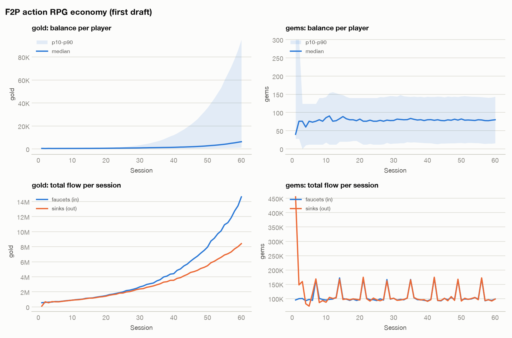

# Economy simulation: F2P action RPG economy (first draft)

2,000 players × 60 sessions, seed 7.

## Findings

- **[HIGH] INFLATION (gold)**: in the last third, faucets exceed sinks 1.51:1 and the median balance keeps rising (~252/session; about 1.4 sessions of income hoarded). Prices tied to gold lose meaning. Fix: add sinks that scale with progression (consumables, upgrades, trade taxes) or slow late faucets.
- **[MEDIUM] INEQUALITY (gold)**: Gini 0.62 at the end. Fine for single-player; in shared economies it prices newcomers out. Consider catch-up faucets or progressive sinks.
- **[MEDIUM] RARE_FOR_MOST**: 87% of simulated players never obtain the SSR in 60 sessions. If it is needed to progress, this is a paywall; if it is cosmetic or a side-grade, say so in the UI.
- **[INFO] DISCLOSURE**: headline rate 0.60% vs consolidated rate 1.61% once pity is counted. Disclose both, plus the pity terms.

## Currency flow

| Currency | Total in | Total out | In/Out | In/Out (last third) | Median end balance | Gini |
|---|---|---|---|---|---|---|
| gold | 251,299,966 | 184,219,302 | 1.36 | 1.51 | 6,290 | 0.62 |
| gems | 6,400,712 | 6,840,800 | 0.94 | 1.00 | 80 | 0.33 |

Real-money cost of one SSR at the best pack rate: ~152.46 on average, 220.26 at the guaranteed ceiling.

## Archetypes

| Archetype | Players | Avg sessions | Avg upgrades | Avg pulls | Avg hits | Share with ≥1 hit | Avg spend |
|---|---|---|---|---|---|---|---|
| casual | 1214 | 32.9 | 22.9 | 14.3 | 0.08 | 7% | 0.00 |
| engaged | 710 | 54.1 | 46.8 | 27.8 | 0.18 | 16% | 0.00 |
| spender | 76 | 57.2 | 49.9 | 75.3 | 0.67 | 62% | 114.40 |

## Gacha: SSR

- Base rate 0.60%; expected pulls per SSR **62.3** (consolidated rate **1.61%**).
- Pulls needed: median 76, 90% of players by 80, 99% by 83, guaranteed by 90.
- Realised hit rate in the simulation: 0.65% per pull (276 hits). It sits below the consolidated rate when most players stop before reaching soft pity.
- Players who never obtained one: 87%.
- Real money per SSR: ~152.46 average, 220.26 at the guaranteed ceiling.

_A model, not a forecast: validate archetype assumptions against telemetry._
