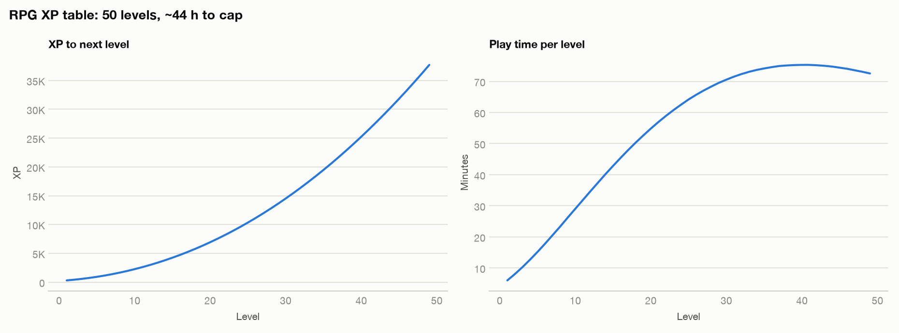

# Progression report: RPG XP table: 50 levels, ~44 h to cap

## poly (exponent = 2.2)

- Total XP to level 50: 654,915
- XP for level 1→2: 300; for 49→50: 37,710
- Half of all XP is earned after level 40 of 50 (80% of the level range): balanced spread.
- Time to max level: 44.3 h. Per level: 6 min (fastest) to 75 min (slowest).
- Table: `rpg-xp-table.csv`

## Sample rows (poly)

| level | xp_to_next | cumulative_xp | growth_ratio | xp_per_hour | hours_this_level | cumulative_hours |
|---|---|---|---|---|---|---|
| 1 | 300 | 0 |  | 3000.0 | 0.1 | 0.0 |
| 2 | 421 | 300 | 1.4037 | 3150.0 | 0.134 | 0.1 |
| 3 | 565 | 721 | 1.3415 | 3307.5 | 0.171 | 0.23 |
| 5 | 923 | 2018 | 1.2609 | 3646.5 | 0.253 | 0.62 |
| 10 | 2252 | 9037 | 1.1639 | 4654.0 | 0.484 | 2.33 |
| 26 | 11122 | 101828 | 1.0748 | 10159.1 | 1.095 | 15.18 |
| 49 | 37710 | 617205 | 1.042 | 31203.8 | 1.209 | 43.12 |
| 50 |  | 654915 |  |  |  | 44.33 |

_Read XP together with income: players feel time per level, not XP._
