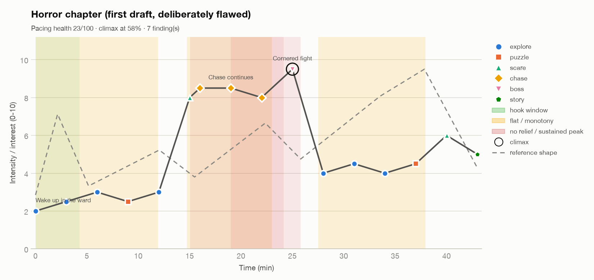

# Worked example: fixing a horror chapter's pacing

**Input:** `horror-chapter-flawed.json`, a 43-minute chapter drafted from a level outline.
**Command:** `python3 scripts/fun_curve.py examples/horror-chapter-flawed.json --out examples/output --reference`

## Diagnosis (pacing health 23/100, climax at 58%)

| # | Finding | Why it hurts | Change |
|---|---|---|---|
| 1 | **MISSING_HOOK**: nothing above 3/10 in the first 4 minutes | Horror needs early *unease*, not a jump scare. Twelve minutes of calm exploration teach the player that nothing will happen | Add a 1.5-minute "shape at the end of the hall" sighting (6/10) that promises the threat without a fight |
| 2 | **FLAT_ZONE 0–12 min** around 2.6 | Low and flat is the biggest quit risk | Interleave stalker sounds during the fuse puzzle and add a reveal in the nurse's notes |
| 3 | **EARLY_CLIMAX**: the cornered fight at 58% is the peak | Players remember the peak and the end; the last 40% feels like an epilogue | Move the confrontation to minute 41 and make the first chase shorter and smaller |
| 4 | **SUSTAINED_PEAK 15–26 min** at ≥ 8 | Eleven minutes of chase numbs fear; the threat becomes a nuisance | Split it into two short chases (minutes 14 and 33), each followed by a safe room |
| 5 | **NO_RELIEF** after the minute-19 chase | No release, so no build-up to the next peak | Safe room + save at minute 16 |
| 6 | **FLAT_ZONE 27–38 min** around 4.3 | The basement is a long, unthreatening clean-up | Add "lights out" (7.5) and a morgue stalk so the second half builds |

## Revised beat list

`horror-chapter-revised.csv` (18 beats). Key moves: an early sighting, two short chases
instead of one long one, safe rooms after both chases, a later climax, and rising peaks
(8 → 7.5 → 8 → 9.5).

| Metric | Before | After |
|---|---|---|
| Pacing health (heuristic) | 23 | 92 |
| Climax position | 58% | 95% |
| Hook strength | 2.5 | 6 |
| Findings | 7 (3 high) | 1 (medium) |

## The remaining finding, and why we accept it

`FLAT_ZONE 4.7–10.2 min` around 4.5: the fuse box and the nurse's notes sit at similar
intensity. In horror, a short dread stretch after the first sighting is intentional: audio
cues carry the tension, and the beat list scores *felt* intensity, which may be under-scored
here. Two acceptable responses:

1. Accept it and verify in playtests (look for idle time or quits between minutes 5 and 10).
2. Rerun with a genre-appropriate threshold: `--flat-min 0.15` accepts dread stretches up to
   15% of the chapter.

Either way, write the decision down. Don't hide the finding.

## Validation plan

- Log time per segment, deaths per segment and quit locations for 20 target-audience
  playtesters.
- After the session, ask each player to draw their fear level over a timeline of the chapter
  (observed curve). Compare it with the revised predicted curve.
- Success: fewer than 10% of sessions end before minute 16 (first safe room), and the
  confrontation is the most-mentioned moment in interviews.
