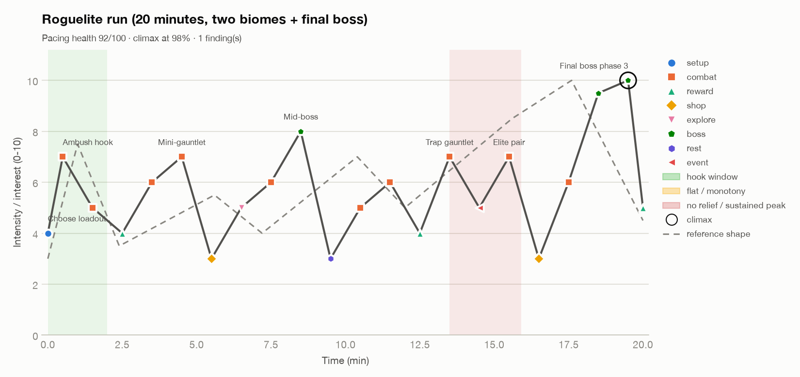

# Worked example: interest curve for a 20-minute roguelite run

**Target shape:** hook within 2 minutes, a sawtooth upward through two biomes, valleys
for shops and rests, a mid-boss near 40–50%, and the final boss in the last 10% with a short
resolution (run summary and unlock).

**Input:** `roguelite-20min-run.csv` (22 beats).
**Command:** `python3 scripts/fun_curve.py examples/roguelite-20min-run.csv --out examples/output --reference`

## Read of the curve

- **Hook:** an ambush at 0:30 (7/10) right after loadout selection.
- **Biome 1 sawtooth:** elite → mini-gauntlet (7) → shop valley (3) → path choice → mid-boss
  (8) at 8:30, which is 43% of the run.
- **Relief:** the fountain and story beat (3) right after the mid-boss.
- **Biome 2:** a new enemy and combo rooms build toward a trap gauntlet (7), a risky event, and
  an elite pair (7). Then a shop and heal (3) before the pre-boss room.
- **Climax:** final boss phases 1–3 (9.5 → 10) at 98%, then the run summary (5).

## Finding (pacing health 92/100)

**NO_RELIEF at 13:30:** the trap gauntlet (7) leads into a risky event (5) and then the elite
pair (7), so there's no real drop for about 2.5 minutes. Players reach the elite pair tired,
and its peak lands softer.

**Options (pick one):**
1. Make the risky event a *calm* choice room (intensity 3): a shrine trade with no combat.
2. Swap the event and the rare boon so the reward valley (4) follows the trap gauntlet.
3. Accept it as a deliberate "gauntlet stretch" that tests endurance before the last shop.
   That's valid for the higher difficulty tiers.

## What a healthy run curve looks like here

| Metric | Value | Why it's healthy |
|---|---|---|
| Climax position | 98% | The ending is the peak; the run summary gives a short resolution |
| Mid-boss | 43% | Splits the run into two arcs |
| Time at intensity ≥ 8 | 8.5% | Peaks stay special |
| Time at intensity ≤ 3 | under 1% | Valleys are brief dips (shops, rest). If playtesters report fatigue, give shops a little more room |

**Next:** log real runs. Use beat timestamps from room-enter events and intensity from
damage taken plus enemies nearby (a simple form of the L4D-style intensity model). Overlay
the observed curve on this one.
